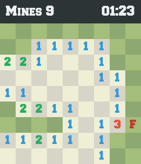

# Démineur en C++ : une vitrine de conception objet

Un démineur jouable dans le terminal et dans une fenêtre SDL, construit pour
montrer **comment un professionnel découpe les responsabilités** : un
domaine pur, des ports, des adaptateurs interchangeables, des ressources
gérées par RAII, et des tests qui pilotent le tout sans clavier ni écran.

La [documentation](docs/README.md) explique chaque concept, pas à pas, à
partir du code. Le dossier [steps/](steps/README.md) propose un labo pour
écrire soi-même une version minimaliste, étape par étape.

```text
  Mines: 9   Time: 00:00
  ┌───┬───┬───┬───┬───┬───┬───┬───┬───┐
9 │ . │ . │ . │ . │ . │ . │ . │ . │ . │
  ├───┼───┼───┼───┼───┼───┼───┼───┼───┤
8 │ . │ . │ . │ . │ . │ . │ . │ . │ . │
  ├───┼───┼───┼───┼───┼───┼───┼───┼───┤
7 │ . │ . │ . │ 1 │ 1 │ 1 │ 1 │ . │ . │
  ├───┼───┼───┼───┼───┼───┼───┼───┼───┤
6 │ . │ . │ . │ 1 │   │   │ 1 │ . │ . │
  ├───┼───┼───┼───┼───┼───┼───┼───┼───┤
5 │ . │ . │ . │ 1 │   │   │ 1 │ . │ . │
  ├───┼───┼───┼───┼───┼───┼───┼───┼───┤
4 │ . │ . │ . │ 1 │ 1 │ 1 │ 3 │ . │ ? │
  ├───┼───┼───┼───┼───┼───┼───┼───┼───┤
3 │ . │ . │ . │ . │ . │ . │ . │ . │ . │
  ├───┼───┼───┼───┼───┼───┼───┼───┼───┤
2 │ . │ . │ . │ . │ . │ . │ . │ . │ . │
  ├───┼───┼───┼───┼───┼───┼───┼───┼───┤
1 │ . │ . │ . │ . │ . │ . │ . │ . │ . │
  └───┴───┴───┴───┴───┴───┴───┴───┴───┘
    A   B   C   D   E   F   G   H   I

B3: reveal, B3?: flag, n: new game, q: quit
>
```



## Architecture

```text
src/
├── core/        domaine : Game, Minefield, Grid<T>, Pos... (aucune entrée/sortie)
├── app/         application : ports (GameView, CommandSink, Clock), Session
├── adapters/
│   ├── console/ terminal : notation d'échecs, rendu Unicode, boucle bloquante
│   └── sdl/     fenêtre : souris, rendu, ressources RAII
└── launcher/    point de composition commun aux deux exécutables
tests/           tests unitaires, doublures de test, test d'architecture
docs/            la documentation pédagogique
```

Les dépendances pointent **vers le centre** : `adapters → app → core`. Un test
([tests/check_layers.cmake](tests/check_layers.cmake)) échoue si un
`#include` viole cette règle.

## Compiler

Prérequis : un compilateur C++20 (GCC 13+, Clang 17+, MSVC 19.36+) et CMake
3.20+. La version graphique demande en plus SDL2 et SDL2_ttf ; si elles sont
absentes, seule la version console est construite.

```bash
# Ubuntu / Debian
sudo apt install build-essential cmake libsdl2-dev libsdl2-ttf-dev

make test                         # compile et lance les tests
make run                          # joue dans le terminal
make run-sdl                      # joue dans une fenêtre
make run ARGS="16 30 99 --seed 42"
```

Sans `make` :

```bash
cmake -S . -B build
cmake --build build
ctest --test-dir build --output-on-failure
./build/minesweeper-console
```

GoogleTest est utilisé s'il est installé, sinon téléchargé automatiquement.

## Jouer

| Console | SDL | Effet |
| --- | --- | --- |
| `B3` | clic gauche | dévoile une case |
| `B3?` | clic droit | pose ou retire un drapeau |
| `n` | `N` | nouvelle partie |
| `q` | `Échap` | quitter |

Les règles complètes sont dans [docs/regles-du-jeu.md](docs/regles-du-jeu.md).
