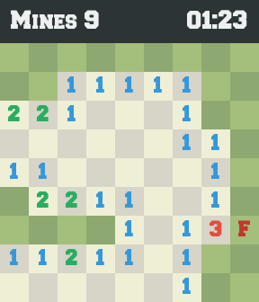
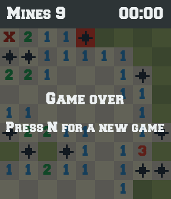

# Le démineur

## Le jeu

Le démineur a été inventé par Robert Donner en 1989, puis rendu célèbre par
Microsoft Windows, qui l'a livré pendant des années avec chaque ordinateur.
Vous pouvez y jouer en ligne, par exemple sur
[minesweeper.online](https://minesweeper.online/).

Une grille cache un certain nombre de mines. Le joueur a deux actions :

1. **Dévoiler** une case. Si c'est une mine, la partie est perdue. Sinon la
   case affiche le **nombre de mines** parmi ses 8 voisines (diagonales
   comprises). Si ce nombre est zéro, ses voisines s'ouvrent automatiquement,
   de proche en proche, et une zone entière se découvre d'un coup.
2. **Marquer** une case d'un drapeau, pour se souvenir qu'on la croit minée.

La partie est **gagnée** quand toutes les cases sans mine sont dévoilées.

Voici une grille 7 × 7 entièrement dévoilée. Chaque chiffre compte les mines
`*` qui le touchent :

```text
  ┌───┬───┬───┬───┬───┬───┬───┐
7 │   │ 1 │ 1 │ 1 │   │   │   │
  ├───┼───┼───┼───┼───┼───┼───┤
6 │   │ 1 │ * │ 1 │   │   │   │
  ├───┼───┼───┼───┼───┼───┼───┤
5 │   │ 2 │ 2 │ 2 │   │   │   │
  ├───┼───┼───┼───┼───┼───┼───┤
4 │   │ 1 │ * │ 1 │   │   │   │
  ├───┼───┼───┼───┼───┼───┼───┤
3 │   │ 1 │ 1 │ 1 │   │   │   │
  ├───┼───┼───┼───┼───┼───┼───┤
2 │   │   │   │ 1 │ 1 │ 1 │   │
  ├───┼───┼───┼───┼───┼───┼───┤
1 │   │   │   │ 1 │ * │ 1 │   │
  └───┴───┴───┴───┴───┴───┴───┘
    A   B   C   D   E   F   G
```

Les règles détaillées, les symboles et toutes les commandes sont rappelés en
annexe, dans [Règles du jeu](regles-du-jeu.md).

---

## Le jeu que nous allons construire

### Dans le terminal

Le joueur tape des coordonnées comme sur un échiquier : `D4` dévoile la case
D4, `G1?` y pose un drapeau. Voici une vraie partie, juste après ces deux
coups :

```text
  Mines: 5   Time: 00:00
  ┌───┬───┬───┬───┬───┬───┬───┐
7 │   │   │   │   │   │   │   │
  ├───┼───┼───┼───┼───┼───┼───┤
6 │   │   │   │   │   │   │   │
  ├───┼───┼───┼───┼───┼───┼───┤
5 │ 1 │ 1 │   │   │ 1 │ 1 │ 1 │
  ├───┼───┼───┼───┼───┼───┼───┤
4 │ . │ 1 │   │   │ 1 │ . │ . │
  ├───┼───┼───┼───┼───┼───┼───┤
3 │ . │ 1 │ 1 │ 2 │ 3 │ . │ . │
  ├───┼───┼───┼───┼───┼───┼───┤
2 │ . │ . │ . │ . │ . │ . │ . │
  ├───┼───┼───┼───┼───┼───┼───┤
1 │ . │ . │ . │ . │ . │ . │ ? │
  └───┴───┴───┴───┴───┴───┴───┘
    A   B   C   D   E   F   G

B3: reveal, B3?: flag, n: new game, q: quit
> A4
```

Un seul clic sur `D4` a ouvert toute la moitié haute. La case `A5` affiche
`1`, et sa seule voisine encore cachée est `A4`… Le joueur tape `A4` quand
même :

```text
  ...
4 │ X │ 1 │   │   │ 1 │ * │ . │
  ├───┼───┼───┼───┼───┼───┼───┤
3 │ . │ 1 │ 1 │ 2 │ 3 │ . │ * │
  ├───┼───┼───┼───┼───┼───┼───┤
2 │ . │ . │ . │ * │ * │ . │ . │
  ├───┼───┼───┼───┼───┼───┼───┤
1 │ . │ . │ . │ . │ . │ * │ ! │
  └───┴───┴───┴───┴───┴───┴───┘
    A   B   C   D   E   F   G

Boom! You lose.  n: new game, q: quit
```

`X` est la mine qui a sauté, `*` les autres mines, et `!` signale que le
drapeau posé en `G1` était faux.

### Dans une fenêtre graphique

Le **même cœur de jeu**, sans en changer une ligne, s'affiche aussi dans une
fenêtre graphique avec la bibliothèque SDL. Clic gauche pour dévoiler, clic
droit pour un drapeau.

{width=35%}

{width=35%}

## Deux visages, un seul jeu

Les deux versions n'ont **rien** en commun à l'écran : l'une écrit des
caractères et lit des lignes de texte, l'autre dessine des pixels et reçoit
des clics de souris. Pourtant, les règles qu'elles appliquent sont écrites
**une seule fois**, dans un cœur qui ne sait ni afficher, ni lire le
clavier, ni même quelle heure il est.

C'est la question centrale de ce document : **comment découper un programme
en objets pour que ce soit possible ?** Ajouter une fenêtre ne doit demander
aucune modification des règles du jeu. Si l'on doit les toucher, c'est que
quelque chose était mal découpé.

## Organisation du document

Le document se lit en deux temps.

**La conception** (chapitres suivants). Chaque chapitre part d'un problème
concret du jeu, montre la solution retenue dans le code de `src/`, puis en
tire un principe réutilisable : objets valeur, encapsulation, agrégat,
polymorphisme, commandes et requêtes, RAII, tests...

**Le labo**. Une progression pour écrire soi-même une version minimaliste du
jeu, étape par étape, en commençant par le cœur et en finissant par la
fenêtre. Chaque étape a son énoncé, ses tests fournis et le code attendu.

Les deux parties se répondent : après chaque étape du labo, le chapitre de
conception correspondant montre comment la version complète traite le même
problème.
