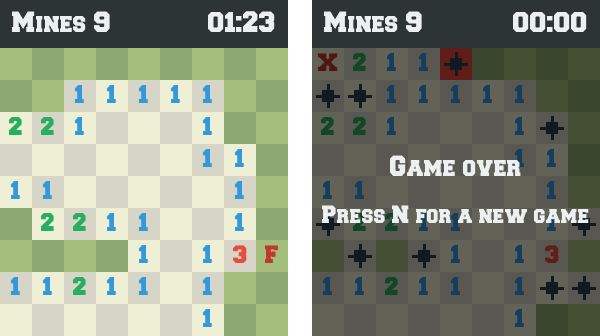

# Le démineur

> **Objectif.** Que tout le monde parle du même jeu : ses règles, son
> vocabulaire, et la cible que nous allons construire, dans le terminal puis
> dans une fenêtre.

## Le besoin

Avant d'écrire une ligne de code, il faut s'entendre sur **ce qu'on
construit**. Un démineur, tout le monde croit le connaître ; mais demandez à
cinq personnes ce qui se passe au premier clic, ou quand on dévoile une case
marquée d'un drapeau, et vous aurez cinq réponses. Chaque désaccord de ce genre
deviendrait plus tard un bug, ou pire, un débat au milieu du code.

Nous avons aussi besoin de voir **la cible** : le même jeu, jouable dans un
terminal et dans une fenêtre graphique. C'est cette double interface qui va
guider toute la conception.

Ce document avance en vingt-quatre étapes. Les huit premières n'écrivent pas
de code : elles analysent le jeu et décident de l'architecture. Les suivantes
construisent le programme de l'intérieur vers l'extérieur, un besoin à la
fois. Le labo `steps/` suit la même progression pour écrire soi-même une
version minimaliste.

## La méthode

Trois choses à faire, dans l'ordre :

1. **Jouer** à la version finie, dans le terminal puis dans la fenêtre. On ne
   conçoit pas bien un jeu auquel on n'a pas joué.
2. **Lire** les règles complètes, rappelées en annexe dans
   [Règles du jeu](regles-du-jeu.md), et noter chaque mot du jeu qu'on y
   rencontre.
3. **Fixer un lexique** : un mot, une définition, pas de synonyme. Ces mots
   seront, dans quelques étapes, les noms de nos types.

## Le livrable

### Le jeu

Le démineur a été inventé par Robert Donner en 1989, puis rendu célèbre par
Microsoft Windows, qui l'a livré pendant des années avec chaque ordinateur.
Vous pouvez y jouer en ligne, par exemple sur
[minesweeper.online](https://minesweeper.online/).

Une grille cache un certain nombre de mines. Le joueur a deux actions :

1. **Dévoiler** une case. Si c'est une mine, la partie est perdue. Sinon la
   case affiche le **nombre de mines** parmi ses 8 voisines (diagonales
   comprises). Si ce nombre est zéro, ses voisines s'ouvrent automatiquement,
   de proche en proche, et une zone entière se découvre d'un coup.
2. **Marquer** une case d'un drapeau, pour se souvenir qu'on la croit minée.

La partie est **gagnée** quand toutes les cases sans mine sont dévoilées.

Voici une grille 7 × 7 entièrement dévoilée. Chaque chiffre compte les mines
`*` qui le touchent :

```text
  ┌───┬───┬───┬───┬───┬───┬───┐
7 │   │ 1 │ 1 │ 1 │   │   │   │
  ├───┼───┼───┼───┼───┼───┼───┤
6 │   │ 1 │ * │ 1 │   │   │   │
  ├───┼───┼───┼───┼───┼───┼───┤
5 │   │ 2 │ 2 │ 2 │   │   │   │
  ├───┼───┼───┼───┼───┼───┼───┤
4 │   │ 1 │ * │ 1 │   │   │   │
  ├───┼───┼───┼───┼───┼───┼───┤
3 │   │ 1 │ 1 │ 1 │   │   │   │
  ├───┼───┼───┼───┼───┼───┼───┤
2 │   │   │   │ 1 │ 1 │ 1 │   │
  ├───┼───┼───┼───┼───┼───┼───┤
1 │   │   │   │ 1 │ * │ 1 │   │
  └───┴───┴───┴───┴───┴───┴───┘
    A   B   C   D   E   F   G
```

### Dans le terminal

Le joueur tape des coordonnées comme sur un échiquier : `D4` dévoile la case
D4, `G1?` y pose un drapeau. Voici une vraie partie, juste après ces deux
coups :

```text
  Mines: 5   Time: 00:00
  ┌───┬───┬───┬───┬───┬───┬───┐
7 │   │   │   │   │   │   │   │
  ├───┼───┼───┼───┼───┼───┼───┤
6 │   │   │   │   │   │   │   │
  ├───┼───┼───┼───┼───┼───┼───┤
5 │ 1 │ 1 │   │   │ 1 │ 1 │ 1 │
  ├───┼───┼───┼───┼───┼───┼───┤
4 │ . │ 1 │   │   │ 1 │ . │ . │
  ├───┼───┼───┼───┼───┼───┼───┤
3 │ . │ 1 │ 1 │ 2 │ 3 │ . │ . │
  ├───┼───┼───┼───┼───┼───┼───┤
2 │ . │ . │ . │ . │ . │ . │ . │
  ├───┼───┼───┼───┼───┼───┼───┤
1 │ . │ . │ . │ . │ . │ . │ ? │
  └───┴───┴───┴───┴───┴───┴───┘
    A   B   C   D   E   F   G

B3: reveal, B3?: flag, n: new game, q: quit
> A4
```

Un seul clic sur `D4` a ouvert toute la moitié haute. La case `A5` affiche
`1`, et sa seule voisine encore cachée est `A4`… Le joueur tape `A4` quand
même :

```text
  ...
4 │ X │ 1 │   │   │ 1 │ * │ . │
  ├───┼───┼───┼───┼───┼───┼───┤
3 │ . │ 1 │ 1 │ 2 │ 3 │ . │ * │
  ├───┼───┼───┼───┼───┼───┼───┤
2 │ . │ . │ . │ * │ * │ . │ . │
  ├───┼───┼───┼───┼───┼───┼───┤
1 │ . │ . │ . │ . │ . │ * │ ! │
  └───┴───┴───┴───┴───┴───┴───┘
    A   B   C   D   E   F   G

Boom! You lose.  n: new game, q: quit
```

`X` est la mine qui a sauté, `*` les autres mines, et `!` signale que le
drapeau posé en `G1` était faux.

### Dans une fenêtre graphique

Le **même cœur de jeu**, sans en changer une ligne, s'affiche aussi dans une
fenêtre graphique avec la bibliothèque SDL. Clic gauche pour dévoiler, clic
droit pour un drapeau.

{width=70%}

Figure: La fenêtre SDL. À gauche, une partie en cours ; à droite, une partie perdue, la mine qui a sauté en rouge. {#fig:sdl}

### Deux visages, un seul jeu

Les deux versions n'ont **rien** en commun à l'écran : l'une écrit des
caractères et lit des lignes de texte, l'autre dessine des pixels et reçoit
des clics de souris. Pourtant, les règles qu'elles appliquent sont écrites
**une seule fois**, dans un cœur qui ne sait ni afficher, ni lire le
clavier, ni même quelle heure il est.

C'est la question centrale de ce document : **comment découper un programme
en objets pour que ce soit possible ?** Ajouter une fenêtre ne doit demander
aucune modification des règles du jeu. Si l'on doit les toucher, c'est que
quelque chose était mal découpé.

### Le lexique

| Terme | Définition |
| --- | --- |
| **grille** | le rectangle de cases ; elle a une taille (lignes × colonnes) |
| **case** | un élément de la grille ; elle cache une mine ou non |
| **position** | la ligne et la colonne qui désignent une case |
| **taille** | le nombre de lignes et de colonnes de la grille |
| **mine** | ce qu'il ne faut pas dévoiler |
| **drapeau** | une marque posée par le joueur sur une case qu'il croit minée |
| **voisines** | les 8 cases qui touchent une case, diagonales comprises |
| **case dévoilée** | une case que le joueur a ouverte ; elle montre son nombre de mines voisines |
| **premier clic** | le premier dévoilement de la partie ; il est toujours sûr |
| **partie gagnée** | toutes les cases sans mine sont dévoilées |
| **partie perdue** | une mine a été dévoilée |
| **chronomètre** | le temps écoulé entre le premier clic et la fin de la partie |

## Les concepts

### Le langage du domaine

Le **langage du domaine** est l'ensemble des mots que les joueurs utilisent
pour parler du jeu, et que le code doit reprendre **tels quels**. Si le lexique
dit *case dévoilée*, le code ne dira ni *opened*, ni *visible*, ni *clicked* :
il dira *revealed*, et partout. Un même concept avec deux noms, c'est deux
chances de se tromper ; un nom du code qui n'est pas dans le lexique, c'est
un concept qu'on a inventé sans le dire.

Regardez les deux captures : `Mines: 5`, `Time: 00:00`, `reveal`, `flag`, `new
game`. Chaque mot de l'écran est un mot du lexique.

### Règle ou fonctionnalité ?

Une **règle** est une phrase sans laquelle le jeu n'est plus le démineur :
« dévoiler une mine fait perdre », « une case affiche le nombre de mines
voisines ». Une **fonctionnalité** est quelque chose que le programme offre
autour du jeu : le chronomètre, la touche « nouvelle partie », la couleur des
chiffres.

Le test est simple : *si on l'enlève, est-ce encore le démineur ?* Sans
chronomètre, oui ; sans voisines comptées, non. Cette distinction paraît
anodine. Elle décidera, à l'[étape 8](08-modules.md), de ce qui entre dans le
cœur du programme et de ce qui reste dehors.

## Vérifier

- Vous avez joué une partie dans le terminal et une dans la fenêtre, et vous
  savez décrire ce qui s'est passé au premier clic.
- Pour chaque terme du lexique, vous pouvez montrer du doigt, sur une des
  captures, à quoi il correspond.
- Vous pouvez classer sans hésiter : « premier clic sûr », « drapeau »,
  « chronomètre », « `--seed 42` » dans *règle* ou *fonctionnalité*.

## À retenir

- On ne conçoit pas un programme dont on n'a pas vu la cible : jouez d'abord.
- Le **lexique** fixe un mot par concept ; le code reprendra ces mots.
- Une **règle** définit le jeu, une **fonctionnalité** l'entoure. Le
  chronomètre n'est pas une règle.
- Deux interfaces sans rien en commun à l'écran, un seul jeu : c'est la
  contrainte qui guidera toute la conception.

## Exercices

1. Les règles disent qu'une case marquée « arrête la propagation
   automatique ». Dessinez une grille 4 × 4 où cette règle change le
   résultat d'un clic. Est-ce une règle ou une fonctionnalité ?
2. Certaines versions du démineur proposent le *chord* : cliquer sur une case
   dévoilée dont tous les drapeaux voisins sont posés ouvre d'un coup ses
   autres voisines. Écrivez la phrase à ajouter au lexique, et décidez si le
   mot *chord* y a sa place ou s'il faut un mot français.
3. Le mode `--seed` rend la position des mines reproductible. Qui en a besoin,
   le joueur ou le programmeur ? Dans quelle colonne du lexique iriez-vous le
   mettre, et pourquoi n'y est-il pas ?
