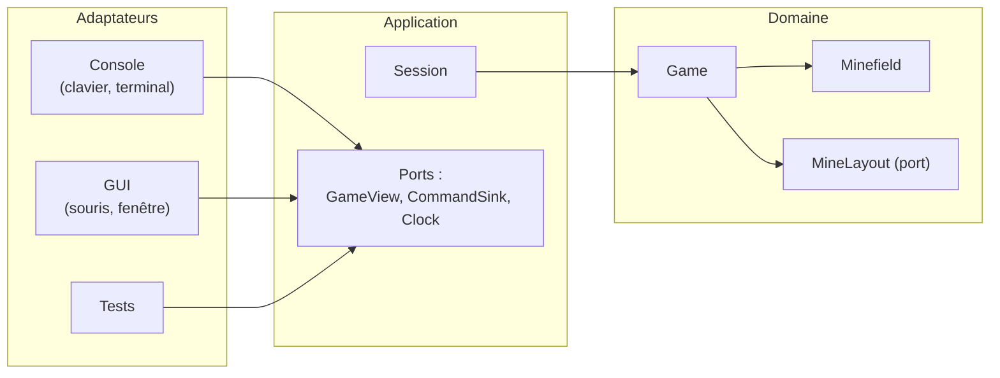
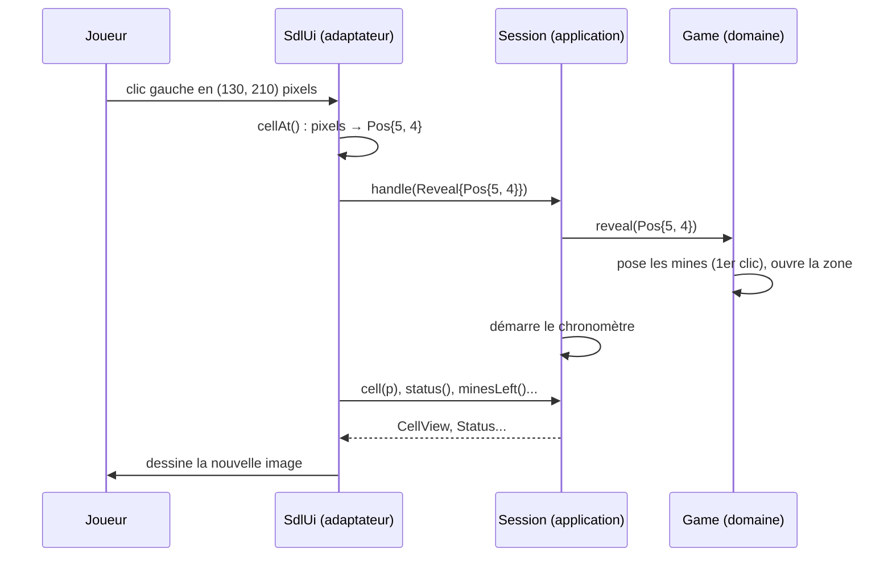

# Vue d'ensemble

> **Objectif.** Comprendre la forme générale du programme avant d'entrer dans
> les détails : quelles sont les couches, qui dépend de qui, et comment un
> clic traverse le système.

## Le problème

On veut un démineur jouable dans un terminal et dans une fenêtre.
Demain, peut-être dans un navigateur. Les règles du jeu, elles, sont les
mêmes partout. Il est donc essentiel de séparer le cœur du jeu (le domaine) de l'interface. C'est là que la programmation orientée objet prend tout son sens.

En programmation objet, on utilise des patrons d'architecture pour organiser le code et séparer les responsabilités. Le patron suggéré ici est l'architecture hexagonale ou architecture ports et adaptateurs (Alistair Cockburn,
2005). Elle vise à créer des systèmes à base de composants d'application qui sont faiblement couplés et indépendants de la technologie : le cœur du jeu est indépendant de l'interface, ce qui permet de changer l'interface sans toucher au cœur du jeu.

## Un cœur et des adaptateurs

On architecture le programme en couches concentriques. Le cœur contient les règles du jeu, et ne connaît ni le clavier, ni l'écran, ni l'heure, ni le hasard. Il est passif : il reçoit des ordres et répond à des questions.

Il convient donc d'identifier les interfaces entre le cœur et le monde extérieur, et de les formaliser en ports. Chaque port est implémenté par un adaptateur qui traduit les ordres du monde extérieur en appels au cœur, et les réponses du cœur en actions sur le monde extérieur.

D'abord les directions de dépendance : le cœur ne connaît rien de l'extérieur, et les adaptateurs ne connaissent que le cœur. Les dépendances pointent toujours vers le centre.

| Couche | Contenu | Connaît | Ne connaît pas |
| --- | --- | --- | --- |
| **Domaine** (`core/`) | les règles du démineur | le C++ standard | l'écran, le clavier, l'heure, SDL |
| **Application** (`app/`) | une session de jeu, le chronomètre | le domaine | la console, SDL |
| **Adaptateurs** (`adapters/`) | traduire le monde extérieur | l'application | — |

## Ports et adaptateurs

Un port est une interface (une classe abstraite) qui décrit un besoin ou
un service, sans dire comment il est réalisé. Il y en a de deux sortes :

1. Les ports d'entrée (*driving ports*) qui permettent au monde extérieur de demander quelque chose à l'application (le temps restant, l'état d'une case, le nombre de mines restantes, etc.). Ils sont implémentés par l'application.
2. Les ports de sortie (*driven ports*) qui permettent à l'application de demander quelque chose au monde extérieur (le hasard, l'heure, etc.). Ils sont implémentés par les adaptateurs.

Un adaptateur est une classe concrète qui connecte un port sur une
technologie. Par exemple, dans la variante CLI, les ports d'entrée sont implémentés par l'adaptateur `ConsoleUI` et pour la variante graphique par `SdlUI`.

Prenons l'exemple simple du hasard. Le cœur du jeu a besoin d'un générateur de nombres aléatoires pour placer les mines. On peut naïvement utiliser `rand()` ou `std::mt19937_64` directement dans le cœur du jeu. Mais alors, le cœur dépend de la bibliothèque standard et ne peut pas être testé de manière déterministe. Il faut à minima pouvoir renseigner au coeur du jeu la graine du générateur, mais cela ne retire pas la dépendance pour autant. Une solution plus propre est de créer un port `MineLayout` qui décrit le service attendu par le coeur du jeu: fournir un agencement de mines aléatoire.

Le port est implémenté par l'adaptateur `RandomMineLayout` qui utilise `std::mt19937_64`. Pour les tests, on peut créer un adaptateur différent p.ex. `FixedMineLayout` qui fournit un agencement fixe de mines.

## Analyse du flux

Pour construire l'architecture, une voie est celle de suivre les flux de données et de contrôle dans le programme. Pour se faire on peut analyser en premier lieu les acteurs du jeu, et les actions qu'ils peuvent effectuer. En ingénierie logicielle on appelle cela un diagramme de cas d'utilisation.

[ Insérer le diagramme de cas d'utilisation permettant d'ientifier les acteurs, les actions et par la suite les flux de données permettant d'établir les ports et les adaptateurs ]

## Le voyage d'une action utilisateur

Supposons le joueur qui effectue une action: cliquer sur une case ou entrer les coordonnées d'une case pour la dévoiler.

1. L'interface utilisateur (console ou SDL) traduit l'action en une commande, par exemple `Reveal{Pos{5, 4}}`.
2. La commande est transmise à l'application qui la transmet au cœur du jeu.
3. Le cœur du jeu applique la commande et modifie son état interne.
4. L'application peut alors interroger le cœur du jeu pour obtenir l'état actuel de la partie et le transmettre à l'interface utilisateur pour mise à jour de l'affichage.

Remarquez :

1. **Les ordres descendent** : l'adaptateur traduit le clic en `Reveal`, une
   commande qui ne parle que de cases.
2. **Les données sont tirées** (*pull*) : après l'ordre, l'adaptateur relit
   l'état par le port de lecture et redessine.
3. **Chaque couche ne parle qu'à sa voisine.** `SdlUi` ne sait pas que `Game`
   existe.

## Les trois exécutables

| Exécutable | Point d'entrée | Ce qu'il assemble |
| --- | --- | --- |
| `minesweeper-console` | [console/main.cpp](../src/adapters/console/main.cpp) | `Session` + `ConsoleUi` |
| `minesweeper-sdl` | [sdl/main.cpp](../src/adapters/sdl/main.cpp) | `Session` + `SdlUi` |
| `minesweeper-tests` | GoogleTest | `Session`, `Game`... + doublures de test |

Les tests sont, au sens propre, **un troisième adaptateur** : ils pilotent le
cœur par les mêmes ports que les interfaces.

## À retenir

- Le domaine est **passif et pur** : il reçoit des ordres et répond à des
  questions. Il ne lit rien, n'affiche rien, ne connaît ni l'heure ni le hasard.
- Un **port** est une interface, un **adaptateur** l'implémente pour une
  technologie donnée.
- La **règle de dépendance** (vers le centre) se vérifie automatiquement.
