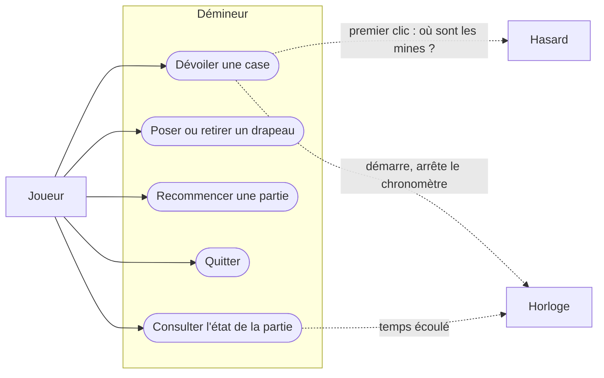

# Les cas d'utilisation

> **Objectif.** Savoir précisément ce que le programme doit permettre, à qui,
> et ce qui se passe dans chaque situation, avant de décider comment le
> construire.

## Le besoin

L'[étape 2](02-elements-du-jeu.md) nous a donné des objets et des verbes.
Mais un verbe isolé, « dévoiler », ne dit pas ce qui se passe quand la case
est une mine, quand elle est déjà marquée, ou quand c'est le tout premier
coup. Ce sont ces **situations** qui font les bugs : le programme marche sur
le cas simple et se trompe sur le cas rare.

Il faut donc une liste **complète** de ce que chaque acteur peut faire, et
pour chaque action, le déroulement normal et les déroulements particuliers.
Cette liste servira deux fois : pour concevoir, et pour **tester**, puisque
chaque situation deviendra un test.

## La méthode

1. Identifier les **acteurs** : tout ce qui, hors du programme, échange avec
   lui. Un acteur **primaire** déclenche quelque chose ; un acteur
   **secondaire** est sollicité par le programme.
2. Pour chaque acteur primaire, lister ses **cas d'utilisation** : un but
   qu'il atteint en une interaction (« dévoiler une case », pas « cliquer »).
3. Pour chaque cas, écrire le **scénario nominal** (tout se passe bien) et
   les **scénarios alternatifs** (ce qui peut en dévier).
4. Dessiner le tout : c'est le **diagramme de cas d'utilisation**.

Les acteurs sont déjà dans le troisième cercle de l'étape 2 : le joueur, qui
agit ; l'horloge et le hasard, à qui le programme demande quelque chose.

## Le livrable

### Les acteurs et leurs cas d'utilisation

| Acteur | Type | Cas d'utilisation |
| --- | --- | --- |
| Joueur | primaire | dévoiler une case ; poser ou retirer un drapeau ; recommencer une partie ; quitter ; consulter l'état (grille, mines restantes, temps) |
| Horloge | secondaire | fournir l'heure courante |
| Hasard | secondaire | fournir un placement de mines |

Les flèches pleines vont du joueur vers le programme : il **déclenche**. Les
flèches pointillées vont du programme vers l'horloge et le hasard : il
**demande**.

### Les scénarios de « dévoiler une case »

C'est le cas le plus riche ; les autres tiennent en une ligne. Chaque
scénario part de la même situation : une partie en cours, une position
valide.

**Nominal : une case sûre.**
Le joueur désigne une case cachée, non marquée, qui ne contient pas de mine.
La case se dévoile et affiche son nombre de mines voisines. La partie
continue.

**Alternatif 1 : une case à zéro voisine.**
Comme le nominal, mais le nombre affiché est zéro. Alors toutes les voisines
se dévoilent à leur tour, et celles qui sont à zéro propagent de proche en
proche. Une case marquée arrête la propagation. Une zone entière s'ouvre d'un
coup.

**Alternatif 2 : une mine.**
La case contient une mine. La partie est **perdue**. Toutes les mines sont
montrées, la mine touchée est distinguée, et les drapeaux posés sur des cases
sûres sont signalés comme faux. Plus aucun coup n'est accepté, sauf
recommencer et quitter.

**Alternatif 3 : la dernière case sûre.**
La case dévoilée était la dernière case sans mine encore cachée. La partie
est **gagnée**, que les mines aient été marquées ou non. Le chronomètre
s'arrête.

**Alternatif 4 : le premier clic.**
Aucune mine n'est encore posée. Le programme demande au hasard un placement
qui évite la case choisie et, si la grille le permet, ses voisines. Les mines
sont posées, le chronomètre démarre, puis le scénario continue comme le
nominal ou l'alternatif 1. Le premier clic ne peut donc jamais perdre.

**Alternatif 5 : une case marquée.**
La case porte un drapeau. Le coup est **refusé** : rien ne change. Le joueur
doit d'abord retirer le drapeau.

### Les autres cas en bref

| Cas | Nominal | Alternatifs |
| --- | --- | --- |
| Poser ou retirer un drapeau | la case cachée bascule : drapeau ou non | case déjà dévoilée : refusé ; partie finie : refusé |
| Recommencer | une nouvelle partie, même taille, même nombre de mines, mines à reposer | aucun |
| Quitter | le programme se termine | aucun |
| Consulter l'état | le programme répond : l'état de chaque case, le nombre de mines restant à marquer, le temps écoulé | partie finie : les mines sont visibles |

### Deux observations

La liste des cas d'utilisation contient deux indices sur la forme que prendra
le programme. Il faut les voir maintenant ; on les retrouvera plus tard dans
le code.

**Les verbes du joueur sont de deux natures.** *Dévoiler*, *marquer* et
*recommencer* **changent** la partie. *Consulter* ne change rien : il **lit**.
On peut consulter cent fois de suite sans conséquence ; on ne peut pas
dévoiler cent fois la même case. Cette séparation entre **ordres** et
**questions** structurera les opérations de la partie à
l'[étape 11](11-la-partie.md) et donnera **deux** interfaces distinctes à
l'[étape 15](15-commandes.md), une pour écrire, une pour lire.

**Les acteurs secondaires sont des besoins du programme.** L'horloge et le
hasard ne décident rien ; le programme leur pose une question et utilise la
réponse. Ce sont des choses dont le programme **a besoin** et qu'il ne
fabrique pas lui-même. À l'[étape 6](06-ports-et-adaptateurs.md), chaque
acteur secondaire deviendra une **prise** sur laquelle on branchera soit le
vrai monde (l'horloge du système, un générateur de nombres aléatoires), soit
un remplaçant pour les tests.

## Les concepts

### Acteur primaire, acteur secondaire

Un **acteur** est quelque chose d'extérieur au programme qui échange avec lui.
L'acteur **primaire** a un but et déclenche l'interaction : le joueur. L'acteur
**secondaire** est sollicité *par* le programme pour l'aider à atteindre ce
but : l'horloge, le hasard. On les dessine de part et d'autre du programme :
les primaires à gauche, les secondaires à droite.

### Cas d'utilisation

Un **cas d'utilisation** est un but qu'un acteur atteint en une interaction
avec le programme, nommé par un verbe et son complément : « dévoiler une
case ». Ce n'est ni un geste (« cliquer ») ni une fonction du code
(`reveal()`) : c'est ce que l'utilisateur veut obtenir.

### Scénario nominal et scénarios alternatifs

Le **scénario nominal** est le déroulement où tout se passe comme prévu. Les
**scénarios alternatifs** sont tous les déroulements qui en dévient : erreur,
cas limite, situation particulière. Un cas d'utilisation n'est complet que
lorsque ses alternatifs sont écrits. La plupart des bugs vivent dans un
alternatif qu'on a oublié d'écrire.

## Vérifier

- **Chaque verbe** du tableau de l'[étape 2](02-elements-du-jeu.md) dont le
  sujet est le joueur apparaît dans un cas d'utilisation.
- **Chaque scénario se termine** dans un état qu'on peut observer : une case
  dévoilée, une partie gagnée, un coup refusé. « Le programme fait ce qu'il
  faut » n'est pas une fin de scénario.
- **Chaque phrase des règles** est couverte par au moins un scénario.
  Relisez [Règles du jeu](regles-du-jeu.md) en cochant.
- Vous savez dire, pour chaque cas d'utilisation, s'il **change** la partie
  ou s'il la **lit**.

## À retenir

- Un **acteur primaire** déclenche, un **acteur secondaire** est sollicité.
  Joueur d'un côté ; horloge et hasard de l'autre.
- Un **cas d'utilisation** est un but, pas un geste ni une fonction.
- Un cas n'est complet qu'avec ses **scénarios alternatifs** ; chacun deviendra
  un test.
- Les cas du joueur **changent** ou **lisent** la partie : deux natures, qui
  donneront deux interfaces.
- Les acteurs secondaires sont des **besoins** du programme : on pourra les
  remplacer.

## Exercices

1. Écrivez les scénarios du cas « poser ou retirer un drapeau » avec le même
   soin que « dévoiler une case ». Que se passe-t-il si le joueur pose plus
   de drapeaux qu'il n'y a de mines ? Les règles le disent-elles ?
2. Ajoutez le cas d'utilisation *chord* (étape 1, exercice 2) au diagramme.
   De quels autres cas dépend-il ? A-t-il besoin d'un acteur secondaire ?
3. On ajoute un **tableau des meilleurs temps** sauvegardé sur le disque.
   Quel nouvel acteur apparaît ? Est-il primaire ou secondaire ? Quel cas
   d'utilisation existant doit changer ?
