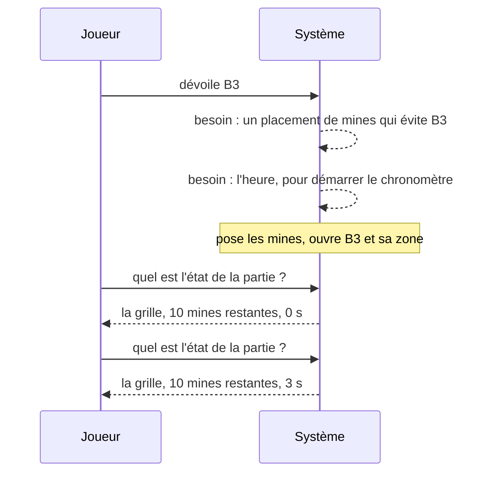
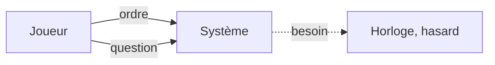

# Un scénario en boîte noire

> **Objectif.** Voir le programme comme une boîte fermée qui reçoit des ordres,
> répond à des questions et demande ce dont elle a besoin, avant de l'ouvrir
> pour regarder dedans.

## Le besoin

Les cas d'utilisation de l'[étape 3](03-cas-d-utilisation.md) disent *quoi*.
Ils ne disent pas encore *dans quel ordre* les échanges ont lieu, ni *qui
parle en premier*. Or c'est l'ordre des échanges qui va décider de la forme
du programme : si le joueur demande et que le programme répond, le programme
est **passif** ; s'il prévient le joueur de lui-même, il est **actif**. Les
deux formes ne se construisent pas pareil.

Avant d'ouvrir la boîte et de parler d'objets, nous avons besoin d'un
scénario **de bout en bout**, raconté avec un seul interlocuteur en face du
joueur : le système, tout entier, vu de l'extérieur.

## La méthode

On prend le scénario nominal de « dévoiler une case » et on le raconte comme
un dialogue à **deux** voix, le Joueur et le Système, sous la forme d'un
**diagramme de séquence** : le temps descend, chaque flèche est un échange.

La consigne qui fait tout l'intérêt de l'exercice : **le Système est une
seule colonne**. Interdit d'y faire apparaître la grille, le chronomètre, ou
quoi que ce soit de l'intérieur. Si une flèche ne peut pas être dessinée
sans ouvrir la boîte, c'est qu'elle n'est pas un échange avec l'extérieur.

Puis on classe chaque flèche. Il n'existe que trois sortes.

## Le livrable

### « Je dévoile B3 »

La partie vient de commencer ; aucune case n'est encore dévoilée.

Trois choses sont visibles dans ce dessin, et elles ne le seraient pas dans
une description en prose.

**Le Système ne prend jamais la parole le premier.** Toutes les flèches
pleines partent du Joueur. Après « dévoile B3 », le Système ne dit pas « voilà
la nouvelle grille » : il attend qu'on la lui demande. Le joueur demande
deux fois de suite, et obtient deux réponses qui ne diffèrent que par le
temps écoulé : demander ne change rien.

**L'ordre et la question sont deux flèches différentes.** « Dévoile B3 » ne
reçoit aucune flèche en retour : l'ordre est exécuté, point. « Quel est
l'état ? » reçoit une réponse et ne modifie rien. On ne confond pas les deux,
et on n'en fait pas une seule flèche « dévoile B3 et rends-moi la grille ».

**Le Système a des besoins qui sortent de la boîte.** Pour poser les mines,
il lui faut un tirage au sort ; pour chronométrer, il lui faut l'heure. Il ne
les fabrique pas : il les demande. Dans le diagramme, ces flèches sont
dessinées en pointillé sur la colonne du Système, parce que nous avons promis
de ne pas ouvrir la boîte ; leur vrai destinataire est à l'extérieur, et nous
le connaissons déjà : les acteurs secondaires de l'étape 3.

### Les trois sortes de flèches

| Flèche | Sens | Change l'état ? | Réponse ? | Exemple |
| --- | --- | --- | --- | --- |
| **Ordre** | entre | oui | non | « dévoile B3 », « pose un drapeau en G1 », « recommence » |
| **Question** | entre | non | oui | « quel est l'état de la partie ? », « combien de mines restent ? » |
| **Besoin** | sort | — | oui | « donne-moi l'heure », « donne-moi un placement de mines » |

Deux flèches entrent, une sort. C'est tout. Chaque échange du démineur, et
de la plupart des programmes, est l'une des trois.

### Ce qu'on rouvrira plus tard

Ce diagramme à deux colonnes est volontairement pauvre. À
l'[étape 7](07-sens-des-flux.md), une fois l'architecture décidée, nous
rouvrirons la boîte et le redessinerons en **quatre** colonnes : le joueur,
l'interface, l'application, le cœur du jeu. Les trois sortes de flèches
seront les mêmes ; on verra seulement par où elles passent. Si une flèche
doit changer de nature en traversant la boîte, c'est que le découpage est
mauvais.

## Les concepts

### Le diagramme de séquence

Un **diagramme de séquence** montre des participants en colonnes et leurs
échanges en flèches, le temps s'écoulant vers le bas. Il répond à la question
que ni le diagramme de cas d'utilisation ni le code ne montrent bien : *dans
quel ordre, et qui parle en premier ?* À ce stade, deux colonnes suffisent ;
plus tard, chaque colonne sera un objet.

### Ordre, question, besoin

Un **ordre** entre dans le système et le modifie sans rien renvoyer. Une
**question** entre dans le système, ne le modifie pas, et renvoie une
réponse. Un **besoin** sort du système vers le monde et revient avec une
réponse. Ce vocabulaire de trois mots sera réutilisé tel quel pour nommer les
**prises** du programme à l'[étape 6](06-ports-et-adaptateurs.md), et la
séparation ordre / question deviendra une règle de code à
l'[étape 11](11-la-partie.md).

### Un système passif

Un système est **passif** quand il ne fait rien de lui-même : il exécute les
ordres qu'on lui donne et répond aux questions qu'on lui pose. Le démineur en
est un : entre deux coups du joueur, il ne se passe strictement rien dans la
partie. Même le chronomètre n'est qu'une soustraction faite au moment où l'on
demande le temps. Un système passif est beaucoup plus simple à construire et
à tester qu'un système qui prend des initiatives ; quand on a le choix, on le
choisit.

## Vérifier

- **Chaque flèche** du diagramme « Je dévoile B3 » est classée dans l'une des
  trois catégories, et une seule :

| Flèche | Catégorie |
| --- | --- |
| dévoile B3 | ordre |
| besoin : un placement de mines | besoin |
| besoin : l'heure | besoin |
| quel est l'état de la partie ? (deux fois) | question |
| la grille, les mines restantes, le temps (deux fois) | réponse à la question |

- **Aucune flèche pleine ne part du Système** vers le Joueur sans qu'une
  question l'ait précédée.
- Les deux réponses successives à la même question ne diffèrent que par le
  temps : **une question ne change rien**.

## À retenir

- Avant d'ouvrir la boîte, raconter un scénario **de bout en bout** à deux
  voix : le Joueur et le Système.
- Il n'existe que **trois sortes de flèches** : l'**ordre** (entre, modifie,
  ne répond pas), la **question** (entre, ne modifie pas, répond), le
  **besoin** (sort, revient avec une réponse).
- Le démineur est un système **passif** : il ne parle jamais le premier.
- Ce diagramme sera rouvert en quatre colonnes à l'étape 7 ; les flèches ne
  changeront pas de nature.

## Exercices

1. Dessinez le même diagramme pour l'alternatif 2 de l'étape 3 : « je dévoile
   une mine ». Quelles flèches changent ? Y a-t-il un nouveau besoin ?
2. Dessinez le diagramme de « recommencer une partie », suivi d'un premier
   clic. Le chronomètre est-il à zéro après « recommence », ou après le
   premier clic ? Quelle flèche vous permet de le savoir ?
3. Un camarade propose que le Système envoie de lui-même « partie perdue ! »
   au Joueur dès qu'une mine est dévoilée. Classez cette flèche. En quoi le
   Système cesse-t-il d'être passif, et qu'est-ce que cela changerait pour
   l'interface graphique, qui redessine la fenêtre plusieurs fois par
   seconde ?
