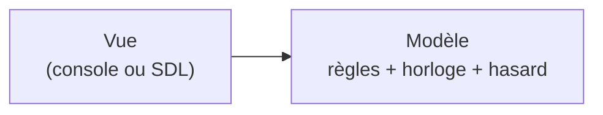
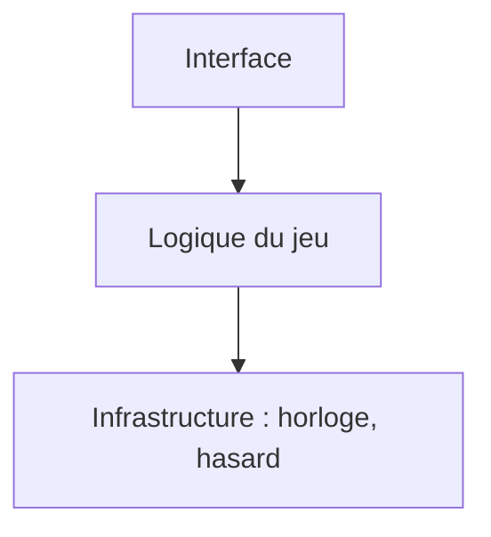
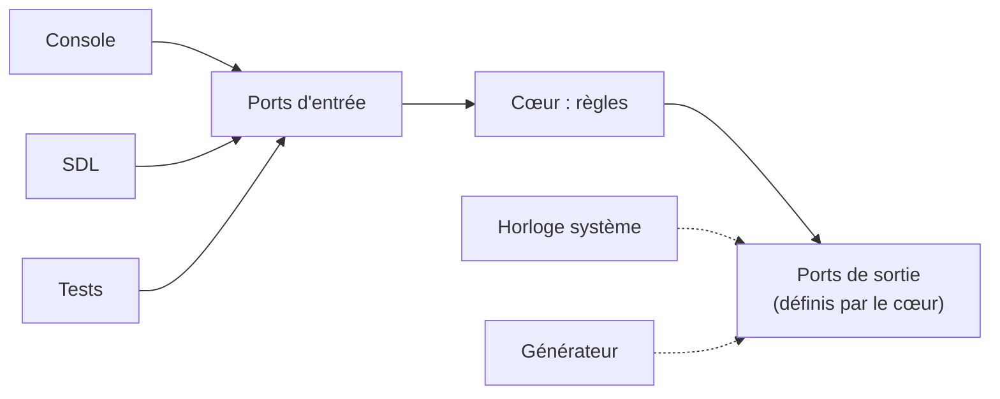
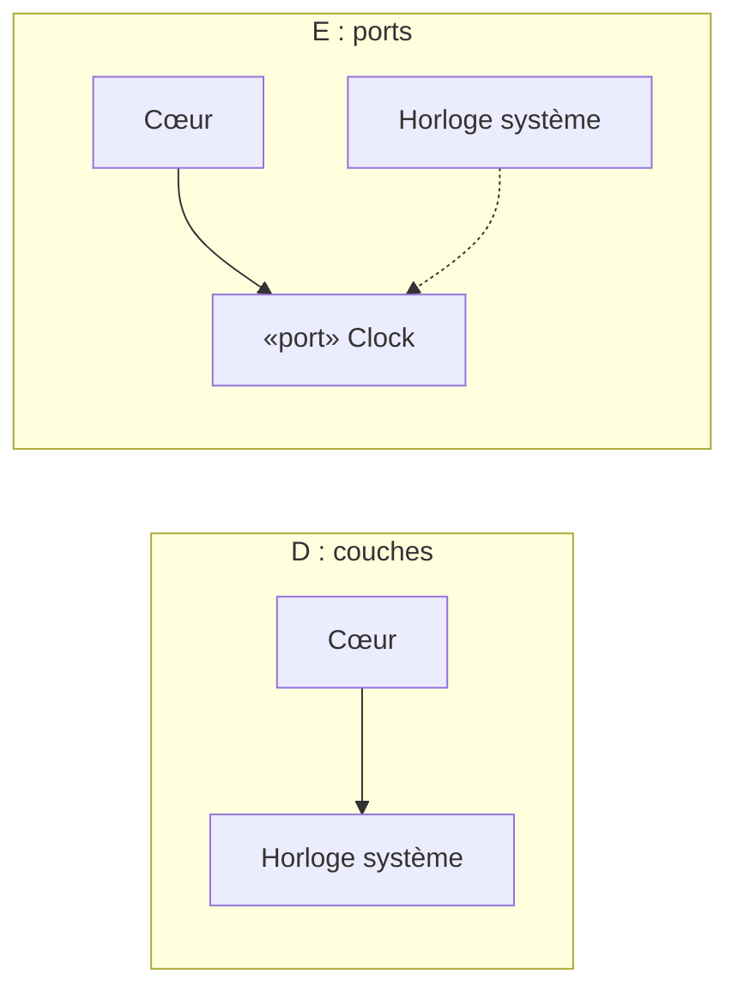

# Choisir une architecture

> **Objectif.** Comparer les façons d'organiser le code d'un démineur et en
> choisir une sur des critères explicites, pas par habitude.

## Le besoin

Les étapes précédentes ont fixé ce que le programme doit faire : recevoir des
**ordres** (dévoiler, marquer, recommencer), répondre à des **questions**
(l'état d'une case, le temps écoulé) et satisfaire deux **besoins** (l'heure,
le hasard). Reste à décider **où** écrire chaque morceau de code.

Le cahier des charges ajoute deux contraintes qui changent tout :

- le jeu doit tourner **dans un terminal et dans une fenêtre**, avec les mêmes
  règles, et peut-être un jour dans un navigateur ;
- les règles doivent être **vérifiées par des tests**, sans joueur devant
  l'écran.

On jugera chaque option avec les trois questions qui reviendront à chaque
étape :

1. Peut-on tester les règles **sans clavier, sans écran, sans attendre** ?
2. A-t-on **écrit deux fois** la même chose ?
3. **Qui dépend de qui**, et dans quel sens ?

## Les options

### A. Tout dans `main()`

```cpp
int main() {
    bool mines[9][9], shown[9][9];
    srand(time(nullptr));
    // ... poser les mines au hasard
    auto start = std::chrono::steady_clock::now();
    while (true) {
        std::cout << grille << temps_écoulé;
        std::cin >> ligne >> colonne;
        // ... dévoiler, propager, tester gagné/perdu
    }
}
```

Tout est au même endroit : les tableaux, le hasard, l'horloge, l'affichage et
la saisie. Pour tester « dévoiler une case à zéro voisine ouvre ses voisines »,
il faut lancer le programme et taper au clavier. Pour ajouter une fenêtre, il
faut recopier la boucle et les règles. Les trois critères échouent.

### B. Une classe `Board` qui fait tout

C'est la version précédente de ce projet. L'intention était bonne (une classe
pour le plateau, des ports), mais `Board` savait tout faire :

```cpp
class Board {
public:
    Board(int rows, int cols, int mines,
          std::random_device rd = std::random_device{});  // le hasard câblé
    Cell& operator()(int r, int c);        // n'importe qui modifie une case
    std::string getSymbol(int r, int c);   // le plateau choisit le caractère
    void revealAll();                      // public, cassait won()
};
```

Trois défauts concrets, relevés à l'[étape 23](23-avant-apres.md) :

- `std::random_device` en argument par défaut : impossible de rejouer une
  partie connue dans un test ;
- `operator()` renvoyait une `Cell&` modifiable, `revealAll()` était public :
  **n'importe quel code** pouvait casser l'état de la partie ;
- `Cell::getSymbol()` choisissait le caractère à afficher : le plateau
  faisait le travail de la console, et SDL devait **décoder ces caractères**.

Critère 1 : à moitié (il y avait des tests, mais ils devaient fouiller les
mines). Critère 2 : le `main` avait deux boucles sous `#ifdef SDL`. Critère 3 :
le plateau dépendait du hasard, de l'horloge et de l'affichage.

### C. Modèle / Vue



Le modèle ne connaît plus la vue : on peut avoir deux vues. C'est un vrai
progrès sur le critère 2. Mais le modèle contient toujours l'horloge système
et le générateur aléatoire : tester le chronomètre oblige à **attendre**, et
tester une partie oblige à **deviner** les mines. Critère 1 échoue encore.

### D. Des couches



La règle « une couche ne dépend que de celle du dessous » met de l'ordre. Mais
regardez la flèche du bas : la logique **dépend** de l'infrastructure. Pour
compiler et tester `Game`, il faut l'horloge et le générateur réels. On n'a
fait que déplacer le problème de C un étage plus bas.

### E. Ports et adaptateurs



Le cœur **définit lui-même** les interfaces dont il a besoin (l'heure, un
placement de mines) et ne connaît aucune implémentation. L'horloge réelle et
le générateur réel se branchent **de l'extérieur**, comme la console et SDL.
Dans un test, on branche une fausse horloge et des mines connues.

## La décision

| Approche | Testable sans écran ni attente ? | Rien d'écrit deux fois ? | Dépendances vers le cœur ? |
| --- | --- | --- | --- |
| A. `main()` | non | non | pas de cœur |
| B. `Board` | partiellement | non (`#ifdef`) | non |
| C. Modèle / Vue | non (horloge, hasard) | oui | à moitié |
| D. Couches | non (horloge, hasard) | oui | non : le cœur dépend du bas |
| E. Ports et adaptateurs | **oui** | **oui** | **oui** |

On retient **E**, l'architecture **hexagonale** ou **ports et adaptateurs**
(Alistair Cockburn, 2005). Son coût est réel : quelques interfaces de plus,
et un endroit où brancher les implémentations. Son bénéfice est exactement ce
que le cahier des charges demande.

Le point à savoir expliquer est **pourquoi D ne suffit pas**. En D comme en E,
les flèches vont dans un seul sens. La différence tient à une seule flèche :
celle entre le cœur et l'horloge. En D, le cœur appelle
`std::chrono::steady_clock::now()` : il **dépend** de l'horloge. En E, le cœur
déclare une interface `Clock`, et c'est l'horloge réelle qui **dépend** de
cette interface en l'implémentant. La flèche a été **retournée**.



## Les concepts

### Couplage

Deux morceaux de code sont **couplés** quand modifier l'un oblige à modifier
l'autre. Dans B, changer le caractère du drapeau dans la console obligeait à
modifier `Cell::getSymbol()` dans le plateau, puis le décodeur côté SDL.

### Cohésion

Un module est **cohésif** quand tout ce qu'il contient sert un même but. Une
classe `Board` qui pose des mines, chronomètre et choisit des caractères a
trois raisons de changer : elle n'est pas cohésive.

### Sens des dépendances

`X` dépend de `Y` si `X` a besoin de `Y` pour compiler (un `#include`, un type
nommé, un appel). On veut que **tout** dépende du cœur, et que le cœur ne
dépende **de rien**. C'est la règle de dépendance ; l'[étape 8](08-modules.md)
la fera vérifier par la machine.

### Inversion de dépendance

Quand le cœur a besoin d'un service extérieur (l'heure), il ne l'appelle pas
directement : il **déclare une interface** et laisse l'extérieur la réaliser.
La dépendance naturelle (cœur → horloge) est inversée (horloge → interface du
cœur). C'est le mécanisme qui distingue E de D.

## Vérifier

Sans écrire de code, on doit pouvoir remplir ce tableau pour l'approche
retenue. Il sera confirmé par le code aux étapes suivantes.

| Chose extérieure | Où vit son code ? | Le cœur peut-il compiler sans elle ? |
| --- | --- | --- |
| clavier, écran | adaptateur console | oui |
| souris, fenêtre | adaptateur SDL | oui |
| horloge système | derrière un port `Clock` | oui |
| générateur aléatoire | derrière un port `MineLayout` | oui |

Critère observable sur le projet fini : aucun fichier de `src/core/` n'inclut
`<iostream>`, `<chrono>` ni SDL, et un test automatique le garantit
([étape 8](08-modules.md)).

## À retenir

- On choisit une architecture sur des **critères**, ici : testable sans
  écran, rien en double, dépendances vers le cœur.
- **Modèle / Vue** sépare l'affichage, mais laisse l'horloge et le hasard dans
  le modèle.
- Des **couches** ne suffisent pas : le cœur dépend encore de ce qui est
  « en dessous ».
- **Ports et adaptateurs** retourne cette dernière flèche : le cœur définit
  les interfaces, l'extérieur les réalise.
- Le mécanisme s'appelle **inversion de dépendance**.

## Exercices

1. On veut ajouter un tableau des meilleurs temps, enregistré dans un fichier.
   Placez-le dans chacune des approches C, D et E. Dans laquelle le cœur
   peut-il être testé sans toucher au disque ?
2. Reprenez la classe `Board` de l'option B et listez ses **raisons de
   changer** (un nouveau thème de couleurs, une règle modifiée, un autre
   générateur). Combien en trouvez-vous ? Que vaudrait ce nombre pour `Game`
   dans l'approche E ?
3. Dessinez l'approche E avec un troisième adaptateur d'entrée : un serveur
   web qui reçoit `POST /reveal`. Que faut-il modifier dans le cœur ?
