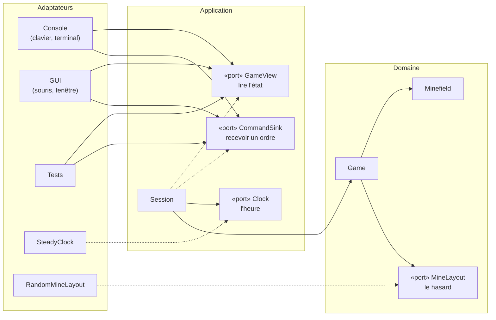

# Ports et adaptateurs

> **Objectif.** Nommer les frontières entre le cœur et le monde, les répartir
> en ports d'entrée et de sortie, et savoir dire pour chacun qui le réalise et
> qui l'utilise.
>
> **Code :** [src/app/ports.hpp](../src/app/ports.hpp),
> [src/core/mine_layout.hpp](../src/core/mine_layout.hpp)

## Le besoin

L'[étape 5](05-choisir-une-architecture.md) a retenu une architecture où le
cœur ne connaît rien de l'extérieur et où tout s'y branche par des interfaces.
Il faut maintenant **lister ces interfaces**. Combien y en a-t-il ? Comment
les nommer ? Qui les écrit, qui les appelle ?

Le travail d'analyse est déjà fait. L'[étape 4](04-scenario-boite-noire.md) a
distingué trois sortes de flèches entre le joueur et le système : les
**ordres** qui entrent, les **questions** qui entrent, les **besoins** qui
sortent. L'[étape 3](03-cas-d-utilisation.md) a identifié un acteur primaire
(le joueur) et deux acteurs secondaires (l'horloge, le hasard). Il suffit de
les croiser.

## Les options

| Option | Idée | Ce qui coince |
| --- | --- | --- |
| Une seule grosse interface `Jeu` | ordres, questions et besoins dans la même classe abstraite | l'horloge devrait implémenter `reveal()` ; l'affichage verrait les méthodes d'écriture |
| Une interface par flèche | ordres / questions / besoins séparés | aucun ; c'est ce qu'on fait |
| Pas d'interface pour les besoins | passer l'heure et les mines en paramètres | le cœur ne sait pas **quand** le premier clic arrive : il doit pouvoir demander les mines à ce moment-là |

La deuxième option découpe naturellement : chaque interface ne contient que
ce qu'un même interlocuteur utilise.

## La décision

### Des flèches aux ports

| Flèche (étape 4) | Acteur (étape 3) | Port | Sorte | Adaptateurs |
| --- | --- | --- | --- | --- |
| ordre entrant | joueur | `CommandSink` | entrée | console, SDL, tests |
| question entrante | joueur | `GameView` | entrée | console, SDL, tests |
| besoin sortant | horloge | `Clock` | sortie | `SteadyClock`, `FakeClock` |
| besoin sortant | hasard | `MineLayout` | sortie | `RandomMineLayout`, `FixedMineLayout` |

Un **port** est une interface, c'est-à-dire une classe abstraite pure, qui
décrit un besoin ou un service **sans dire comment il est réalisé**. Il y en a
de deux sortes :

1. Les **ports d'entrée** (*driving ports*) : ce que le monde extérieur peut
   demander à l'application. Ici `CommandSink` (envoyer un ordre) et
   `GameView` (lire l'état).
2. Les **ports de sortie** (*driven ports*) : ce dont l'application a besoin
   du monde extérieur. Ici `Clock` (l'heure) et `MineLayout` (le hasard).

Un **adaptateur** est une classe concrète qui branche un port sur une
technologie : `ConsoleUi` sur le clavier et le terminal, `SdlUi` sur la souris
et une fenêtre, `SteadyClock` sur l'horloge du système, `RandomMineLayout` sur
un générateur pseudo-aléatoire.

Voici les trois ports de l'application tels qu'ils sont écrits :

```cpp
class GameView {
public:
    virtual ~GameView() = default;
    virtual Size size() const = 0;
    virtual CellView cell(Pos p) const = 0;
    virtual Status status() const = 0;
    virtual int minesLeft() const = 0;
    virtual std::chrono::seconds elapsed() const = 0;
};

class CommandSink {
public:
    virtual ~CommandSink() = default;
    virtual void handle(const Command& command) = 0;
};

class Clock {
public:
    using TimePoint = std::chrono::steady_clock::time_point;
    virtual ~Clock() = default;
    virtual TimePoint now() const = 0;
};
```

Et le port du domaine, déclaré dans `core/` parce que c'est `Game` qui en a
besoin, avec son adaptateur réel juste en dessous :

```cpp
class MineLayout {
public:
    virtual ~MineLayout() = default;
    virtual std::vector<Pos> place(Size size, int count, Pos firstClick) = 0;
};

class RandomMineLayout final : public MineLayout {
public:
    explicit RandomMineLayout(std::uint64_t seed) : rng_(seed) {}
    std::vector<Pos> place(Size size, int count, Pos firstClick) override;
private:
    std::mt19937_64 rng_;
};
```

### La grande image



Flèche pleine : *utilise* ; flèche pointillée : *réalise* (implémente
l'interface).

Au centre de la couche application se trouve `Session`. C'est la **séance de
jeu** : la partie en cours (`Game`), le chronomètre, et la configuration qui
permet de recommencer. Il y en a exactement **une** par exécution du programme,
créée au démarrage ; le `Game` qu'elle contient, lui, est remplacé à chaque
nouvelle partie. `Session` ne contient aucune règle du démineur : elle
**relie**. Vers l'extérieur, elle *réalise* les deux ports d'entrée, `GameView`
et `CommandSink` : c'est elle que les adaptateurs lisent et à qui ils envoient
leurs ordres, sans savoir qu'il s'agit d'une `Session`. Vers l'intérieur, elle
*utilise* les deux ports de sortie : `Clock` pour le chronomètre, et
`MineLayout` qu'elle transmet au `Game`. L'[étape 17](17-session.md) lui est
consacrée.

### Qui réalise, qui utilise

| Port | Sorte | Réalisé par | Utilisé par |
| --- | --- | --- | --- |
| `GameView` | entrée | `Session` | `ConsoleUi`, `SdlUi`, les tests |
| `CommandSink` | entrée | `Session` (et `RecordingSink` en test) | `ConsoleUi`, `SdlUi` |
| `Clock` | sortie | `SteadyClock` (et `FakeClock` en test) | `Session` |
| `MineLayout` | sortie | `RandomMineLayout` (et `FixedMineLayout` en test) | `Game`, qui le reçoit de `Session` |

On y voit le rôle de `Session` : elle est des deux côtés, implémentation des
ports d'entrée et cliente des ports de sortie.

### L'exemple du hasard

Le cœur du jeu a besoin de placer des mines au hasard. On pourrait appeler
`std::mt19937_64` directement dans `Game`. Mais alors un test de règle
dépendrait du générateur : pour vérifier « dévoiler une mine fait perdre », il
faudrait d'abord chercher où les mines sont tombées. Donner la graine aide,
mais ne retire pas la dépendance.

La solution est un port `MineLayout` qui décrit le service attendu par le
cœur : « donne-moi `count` positions de mines pour une grille `size`, sachant
que le premier clic est en `firstClick` ». `RandomMineLayout` le réalise avec
`std::mt19937_64` ; dans les tests, `FixedMineLayout` renvoie la liste qu'on
lui a donnée :

```cpp
class FixedMineLayout final : public MineLayout {
public:
    explicit FixedMineLayout(std::vector<Pos> mines) : mines_(std::move(mines)) {}
    std::vector<Pos> place(Size, int, Pos firstClick) override {
        ++calls;
        lastFirstClick = firstClick;
        return mines_;
    }
    int calls = 0;
    std::optional<Pos> lastFirstClick;
private:
    std::vector<Pos> mines_;
};
```

Le même mécanisme sera construit en détail à l'[étape 16](16-hasard.md).

## Les concepts

### Port

Une interface qui décrit **quoi**, jamais **comment**. `Clock::now()` dit
« donne-moi l'heure » ; rien n'indique si elle vient du système ou d'un test.

### Adaptateur

Une classe concrète qui réalise ou utilise un port pour **une** technologie.
On peut en écrire autant qu'on veut sans toucher au cœur : c'est ce qui rend
la fenêtre SDL possible après la console.

### Entrée et sortie

La phrase à savoir écrire, parce qu'elle est confondue une fois sur deux :

> Un port **d'entrée** est **réalisé** par l'application et **utilisé** par
> l'adaptateur. Un port **de sortie** est **utilisé** par l'application et
> **réalisé** par l'adaptateur.

Dans les deux cas, c'est l'application qui **possède** le port. La différence
est le sens de l'appel.

### Les tests sont un adaptateur

`FixedMineLayout`, `FakeClock` et `RecordingSink` réalisent les mêmes ports
que les adaptateurs réels. Les tests pilotent le cœur **par les mêmes ports**
que la console et SDL : ils n'ont aucun accès privilégié. Si un test ne peut
pas faire quelque chose par les ports, une interface ne le pourra pas non plus.

## Vérifier

Pour chacun des quatre ports, on doit savoir dire, sans regarder le tableau :
sa sorte, qui le réalise, qui l'utilise. Le critère observable dans le code :
chaque port est une classe sans données, avec un destructeur virtuel et
uniquement des méthodes virtuelles pures.

Deuxième vérification : `ConsoleUi::run` et `SdlUi::run` ont la **même**
signature : un `const GameView&` et un `CommandSink&`. Aucune des deux ne nomme
`Session`.

## À retenir

- Un **port** est une interface ; un **adaptateur** la branche sur une
  technologie.
- Les ports viennent des flèches de l'analyse : ordres et questions → ports
  d'entrée ; besoins → ports de sortie. Les **acteurs secondaires** deviennent
  des ports de sortie.
- Port d'entrée : réalisé par l'application, utilisé par l'adaptateur. Port de
  sortie : l'inverse.
- `Session` réalise les ports d'entrée et utilise les ports de sortie : c'est
  elle qui **relie**.
- Les **tests** sont un adaptateur comme les autres.

## Exercices

1. On ajoute un tableau des meilleurs temps, sauvegardé sur disque. Est-ce un
   port d'entrée ou de sortie ? Écrivez sa déclaration (une classe abstraite,
   une ou deux méthodes). Qui la réalise, qui l'utilise ?
2. Un camarade propose de fusionner `GameView` et `CommandSink` en une seule
   interface `GamePort`. Quelle fonction perd une garantie qu'elle avait
   (indice : regardez le type du paramètre de `render`) ?
3. `MineLayout` est déclaré dans `core/` alors que `Clock` est dans `app/`.
   Pourquoi ? Que se passerait-il si `MineLayout` était dans `app/` ?
