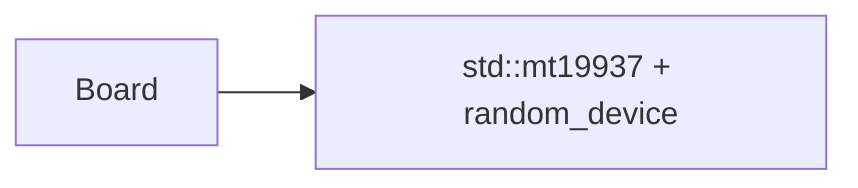
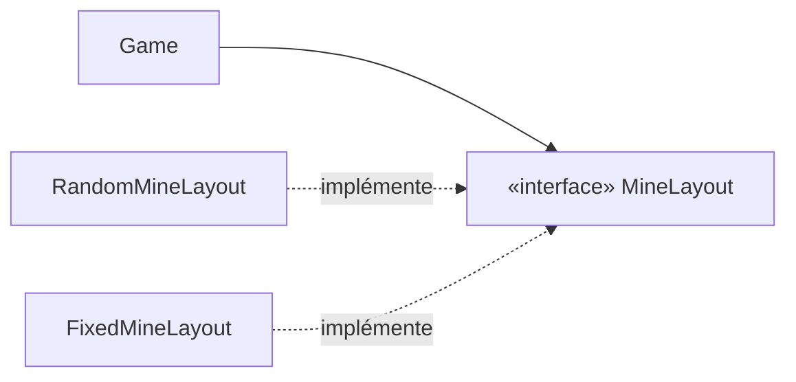

# Polymorphisme et ports : `MineLayout`, `Clock`

> **Objectif.** Comprendre à quoi sert vraiment une classe abstraite :
> **inverser une dépendance** pour rendre le code testable et remplaçable.
>
> **Code :** [src/core/mine_layout.hpp](../src/core/mine_layout.hpp),
> [src/app/ports.hpp](../src/app/ports.hpp)

## Le problème : le hasard rend le code intestable

Pour poser les mines, il faut du hasard. La solution naïve est de créer un
générateur directement dans le plateau :

```cpp
class Board {
    std::mt19937 rng_{std::random_device{}()};   // graine imprévisible
    void placeMines() { /* shuffle avec rng_ */ }
};
```

Comment tester alors « révéler une case vide ouvre toute la zone » ? On ne sait
pas où sont les mines ! Les tests doivent fouiller le plateau pour les
retrouver, ou espérer qu'une graine donne une configuration intéressante.

Le temps pose le même problème : un chronomètre qui lit
`std::chrono::steady_clock::now()` ne se teste qu'en **attendant vraiment**.

## La solution : dépendre d'une abstraction

On ne dit plus à `Game` *comment* placer les mines. On lui dit seulement
**qu'il existe quelqu'un qui sait le faire** :

```cpp
class MineLayout {
public:
    virtual ~MineLayout() = default;
    virtual std::vector<Pos> place(Size size, int count, Pos firstClick) = 0;
};
```

Puis on fournit des réalisations concrètes :

```cpp
// En production : le vrai hasard (mais avec une graine injectée).
class RandomMineLayout final : public MineLayout {
public:
    explicit RandomMineLayout(std::uint64_t seed);
    std::vector<Pos> place(Size, int, Pos) override;
};

// Dans les tests : les mines exactement là où le test les veut.
class FixedMineLayout final : public MineLayout { ... };
```

`Game` reçoit un `MineLayout&` et ne sait pas lequel il manipule. C'est le
**polymorphisme** : un même appel, `layout_->place(...)`, exécute un code
différent selon l'objet réel.

## Le vocabulaire C++

| Mot-clé | Rôle |
| --- | --- |
| `virtual` | la méthode est choisie **à l'exécution**, selon le type réel de l'objet |
| `= 0` | méthode **virtuelle pure** : pas d'implémentation, la classe devient **abstraite** (on ne peut pas l'instancier) |
| `virtual ~MineLayout() = default` | **indispensable** : sans lui, détruire un objet dérivé via un pointeur sur la base est un comportement indéfini |
| `override` | demande au compilateur de vérifier qu'on redéfinit bien une méthode virtuelle (faute de frappe = erreur de compilation) |
| `final` | interdit de dériver de cette classe : l'intention est explicite |

Une classe qui ne contient que des méthodes virtuelles pures (et un
destructeur virtuel) joue le rôle d'**interface** : un contrat sans
implémentation.

## L'inversion de dépendance

Regardons les flèches de dépendance.

**Avant** : le domaine dépend d'un détail technique.



**Après** : le domaine définit l'interface dont il a besoin, et le détail
technique s'y conforme.



C'est le **principe d'inversion des dépendances** (le « D » de SOLID) :

> Les modules de haut niveau ne dépendent pas des modules de bas niveau. Les
> deux dépendent d'abstractions.

L'interface `MineLayout` appartient au **domaine** (`core/`), pas à
l'implémentation. C'est le domaine qui dit « voici ce dont j'ai besoin ».

## L'injection de dépendance

Qui crée le `RandomMineLayout` et le passe à `Game` ? Personne dans le domaine.
C'est le **point de composition**, tout au bord du programme
([launch.cpp](../src/launcher/launch.cpp)) :

```cpp
RandomMineLayout layout{options.seed.value_or(std::random_device{}())};
SteadyClock clock;
Session session{options.game, layout, clock};
```

Les dépendances sont **injectées par le constructeur**. Aucune classe ne va
chercher elle-même ses collaborateurs, ni dans une variable globale, ni dans un
singleton. Résultat :

- en production, on injecte le vrai hasard et la vraie horloge ;
- dans les tests, on injecte `FixedMineLayout` et `FakeClock`
  ([test_doubles.hpp](../tests/test_doubles.hpp)) ;
- avec `--seed 42`, une partie devient **reproductible**, ce qui est précieux
  pour un rapport de bug.

Même `std::random_device` (la seule source vraiment imprévisible) n'apparaît
qu'au point de composition. Le domaine est **déterministe**.

## Faire confiance, mais vérifier le contrat

Une interface est un **contrat** : `place()` doit renvoyer exactement `count`
positions distinctes, dans la grille, sans le premier clic. Mais `Game` ne
contrôle pas qui l'implémente. Il vérifie donc ce qu'il reçoit :

```cpp
const Minefield& Game::plant(Pos firstClick) {
    const std::vector<Pos> mines = layout_->place(size(), mines_, firstClick);
    if (std::ssize(mines) != mines_ || std::ranges::find(mines, firstClick) != mines.end())
        throw std::logic_error("Game: the mine layout broke its contract");
    return field_.emplace(size(), mines);
}
```

Les autres clauses (positions dans la grille, sans doublon) sont vérifiées par
le constructeur de `Minefield`. L'agrégat ne laisse **rien** entrer qui
pourrait casser ses invariants, même venant d'un collaborateur.

## Le port `Clock`

Même idée pour le temps :

```cpp
class Clock {
public:
    using TimePoint = std::chrono::steady_clock::time_point;
    virtual ~Clock() = default;
    virtual TimePoint now() const = 0;
};
```

`SteadyClock` (dans le lanceur) lit la vraie horloge. `FakeClock` (dans les
tests) avance quand le test le décide :

```cpp
clock.advance(4s);
EXPECT_EQ(session.elapsed(), 4s);   // instantané, et toujours exact
```

## Quand **ne pas** créer d'interface

Une interface a un coût : une indirection, un fichier de plus, une couche que
le lecteur doit traverser. Ce projet n'en crée que pour l'une de deux raisons :

1. **Substituer** : il existe réellement une seconde implémentation, en général
   celle des tests ;
2. **Restreindre une frontière** : un client ne doit voir qu'une partie des
   capacités d'un objet.

| Interface | Implémentation réelle | Raison |
| --- | --- | --- |
| `MineLayout` | `RandomMineLayout` | substitution : `FixedMineLayout` dans les tests |
| `Clock` | `SteadyClock` | substitution : `FakeClock` dans les tests |
| `CommandSink` | `Session` | substitution : `RecordingSink` dans les tests |
| `GameView` | `Session` | frontière : l'interface ne voit que des questions, et ignore tout de `Session` |

Il n'y a **pas** d'interface `IGame` ni `IMinefield` : rien ne les
remplacerait et aucune frontière ne les justifie. Une interface sans raison
n'est que de la cérémonie.

## À retenir

- Le polymorphisme sert surtout à **découpler** : celui qui utilise ne connaît
  pas celui qui réalise.
- Une base polymorphe a **toujours** un destructeur virtuel.
- Utilisez **`override`** systématiquement, et **`final`** quand rien ne doit
  dériver.
- **Inversion des dépendances** : le domaine définit les interfaces dont il a
  besoin.
- **Injection** : les dépendances arrivent par le constructeur, et sont
  assemblées au point de composition.
- Le hasard et le temps sont des **dépendances** comme les autres.

## Pour réfléchir

1. Écrivez (sur papier) une `MineLayout` qui garantit une partie résoluble
   sans deviner. Faut-il modifier `Game` ?
2. Pourquoi `RandomMineLayout` n'a-t-il pas de constructeur par défaut qui
   appellerait `std::random_device` ?
