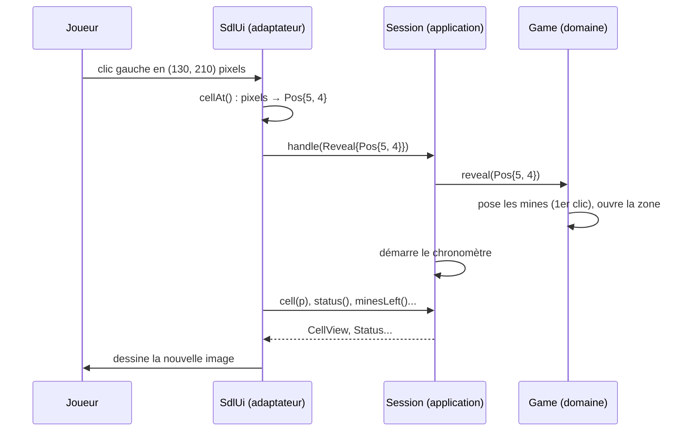

# Le sens des flux

> **Objectif.** Décider qui appelle qui, pour qu'un ordre du joueur traverse
> le système sans jamais créer de dépendance dans le mauvais sens.
>
> **Code :** [console_ui.cpp](../src/adapters/console/console_ui.cpp),
> [sdl_ui.cpp](../src/adapters/sdl/sdl_ui.cpp)

## Le besoin

Les ports sont nommés ([étape 6](06-ports-et-adaptateurs.md)). Mais une
interface ne dit pas **qui prend l'initiative**. Quand le joueur clique, qui
appelle qui ? Quand la grille change, qui prévient l'écran ? Et surtout : qui
possède la boucle du programme, celle qui attend le prochain geste du joueur ?

Deux mauvaises réponses créent une dépendance du cœur vers l'extérieur, ce qui
annulerait tout le travail de l'[étape 5](05-choisir-une-architecture.md).

## Les options

### Où est la boucle ?

Une première conception, très répandue, met la boucle **dans le jeu** :

```cpp
void Game::loop() {
    while (!over()) {
        auto action = input_->read();   // le jeu « tire » l'entrée
        apply(action);
        display_->show(*this);
    }
}
```

Cela fonctionne pour une console, mais pas ailleurs :

- avec **SDL**, la bibliothèque fournit les événements dans **sa** boucle
  (`SDL_PollEvent`) ;
- dans un **navigateur**, il n'y a pas de boucle : une requête arrive, on
  répond ;
- dans un **test**, on veut appeler `reveal()` et vérifier le résultat, sans
  rien simuler.

L'autre conception met la boucle **dans l'adaptateur**, et le cœur ne fait
que répondre.

### Comment l'écran apprend-il que la grille a changé ?

| Option | Mécanisme | Dépendance créée |
| --- | --- | --- |
| **Push** (Observateur) | le cœur notifie des abonnés à chaque changement | le cœur connaît une interface d'abonné, et doit décider *quand* notifier |
| **Pull** | l'adaptateur relit l'état quand il veut redessiner | aucune : l'adaptateur appelle `GameView`, qu'il connaît déjà |

## La décision

Le cœur est **passif** : il ne lit rien, il ne boucle pas, il ne prévient
personne. C'est l'adaptateur qui possède la boucle de sa technologie, envoie
les ordres et relit l'état. Sur le scénario de l'[étape 4](04-scenario-boite-noire.md),
maintenant ouvert en quatre colonnes :



Trois règles se lisent sur ce diagramme :

1. **Les ordres descendent.** L'adaptateur traduit le clic en `Reveal`, une
   commande qui ne parle que de cases, et l'envoie vers le centre par
   `CommandSink`.
2. **Les données sont tirées** (*pull*). Après l'ordre, l'adaptateur relit
   l'état par `GameView` et redessine. Aucune flèche ne part du domaine vers
   la gauche de sa propre initiative.
3. **Chaque couche ne parle qu'à sa voisine.** `SdlUi` appelle `Session` (sous
   ses deux ports), `Session` appelle `Game`. `SdlUi` ne nomme jamais `Game`.

### Deux boucles, deux styles

Console : une boucle **bloquante** sur l'entrée.

```cpp
void ConsoleUi::run(const GameView& view, CommandSink& commands) {
    render(out_, view, style_);
    std::string line;
    for (;;) {
        out_ << "> " << std::flush;
        if (!std::getline(in_, line)) return;

        const auto input = parseInput(line, view.size());
        if (!input) {
            out_ << "Unknown command. Examples: B3, B3?, n, q\n";
            continue;
        }
        if (std::holds_alternative<Quit>(*input)) return;

        commands.handle(std::get<Command>(*input));
        render(out_, view, style_);
    }
}
```

SDL : une boucle **d'événements** qui se réveille à cadence fixe.

```cpp
constexpr Uint32 kFrameMs = 200;  // wake up regularly so the HUD clock ticks

void SdlUi::run(const GameView& view, CommandSink& commands) {
    for (;;) {
        draw(view);
        SDL_Event event;
        if (!SDL_WaitEventTimeout(&event, kFrameMs)) continue;
        do {
            if (isQuit(event)) return;
            if (const auto command = translate(event)) commands.handle(*command);
        } while (SDL_PollEvent(&event));
    }
}
```

Elles n'ont **rien en commun**, et c'est très bien ainsi : chacune épouse sa
technologie. Ce qu'elles partagent, ce sont les deux ports qu'elles reçoivent
en paramètre. Remarquez le `kFrameMs` : SDL redessine toutes les 200 ms même
sans événement, parce que le chronomètre avance. En *pull*, cela ne coûte
qu'un appel à `elapsed()` ; en *push*, le cœur devrait émettre une
notification par seconde pour une horloge, ce qui n'a aucun sens.

## Les concepts

### Qui possède la boucle

La boucle appartient à **l'adaptateur**, parce que c'est lui qui connaît sa
technologie : `std::getline` bloque, `SDL_WaitEventTimeout` attend avec un
délai, un serveur web n'a pas de boucle du tout. Un cœur qui boucle impose
son rythme à tout le monde.

### Pull et push

En **pull**, le consommateur va chercher la donnée quand il en a besoin. En
**push**, le producteur la lui envoie quand elle change. Le pull suffit ici :
la console redessine tout après chaque saisie, SDL redessine chaque image
(mode immédiat), et relire une grille de 30 × 16 cases prend quelques
microsecondes.

### L'Observateur, nommé et écarté

Le patron **Observateur** (*publish/subscribe*) est la forme classique du
push : le cœur tient une liste d'abonnés et les notifie.

```cpp
class GameObserver {
public:
    virtual ~GameObserver() = default;
    virtual void cellsChanged(std::span<const Pos> cells) = 0;
    virtual void statusChanged(Status status) = 0;
};
```

Il devient utile quand l'interface est en **mode retenu** (widgets Qt, DOM
d'une page web : chaque case est un objet à mettre à jour individuellement),
quand **plusieurs vues** doivent réagir, ou quand des changements arrivent
**sans action de l'interface** (partie en réseau, *replay*). Ce projet n'a
aucun de ces besoins. Ajouter un patron sans besoin, c'est payer sa
complexité sans son bénéfice. Et si on l'ajoutait un jour, la règle resterait :
la notification dit *quoi* a changé, l'abonné relit *comment* via `GameView`.

### Une couche, une voisine

Si `SdlUi` appelait `Game` directement, il serait couplé à la classe concrète
du domaine : changer `Game` casserait SDL. En passant par `Session`, il ne
connaît que deux interfaces stables. C'est le critère « qui dépend de qui »
appliqué aux appels, et pas seulement aux `#include`.

## Vérifier

Sur le diagramme de séquence, **chaque flèche** relie deux colonnes voisines,
et toutes les flèches pleines (les appels) vont de gauche à droite. Les seules
flèches vers la gauche sont des **retours** de valeurs (pointillées).

Dans le code : la signature `run(const GameView&, CommandSink&)` des deux
adaptateurs suffit à prouver la règle 3. Le `const` sur `GameView` prouve la
règle 2 : par ce paramètre, un adaptateur ne peut que lire.

## À retenir

- Le cœur est **passif** : il ne lit rien, ne boucle pas, ne notifie personne.
- **L'adaptateur possède la boucle**, adaptée à sa technologie.
- **Les ordres descendent, les données sont tirées**, chaque couche ne parle
  qu'à sa voisine.
- **Pull** suffit quand on redessine tout. **Observateur** se justifie avec une
  interface à mode retenu, plusieurs vues, ou des changements extérieurs.

## Exercices

1. Esquissez un adaptateur HTTP : `POST /reveal {"row": 2, "col": 3}`. Où est
   la boucle ? Que renvoie la réponse, et par quel port l'obtient-on ?
2. On veut jouer un son quand une mine explose. En pull, comment l'adaptateur
   SDL le sait-il ? Qu'est-ce que cela coûte par rapport à un Observateur ?
3. Supposez que `Game::reveal` renvoie la liste des cases ouvertes, pour
   éviter de tout redessiner. Laquelle des trois règles est fragilisée, et
   pourquoi est-ce déjà un petit pas vers le push ?
