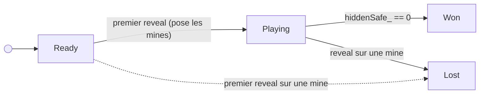

# La partie

> **Objectif.** Écrire les règles : dévoiler, marquer, gagner, perdre,
> refuser les coups interdits. Savoir **où placer une règle**, et ce qu'est
> une source unique de vérité.
>
> **Code :** [src/core/game.hpp](../src/core/game.hpp),
> [src/core/game.cpp](../src/core/game.cpp)

Cette étape correspond à l'étape 3 du [labo](../steps/README.md).
L'ouverture en cascade, qui est un algorithme à part entière, est traitée à
l'[étape 13](13-ouverture-en-cascade.md).

## Le besoin

On a un champ de mines immuable. Il manque **ce que le joueur fait** : quelles
cases il a dévoilées, où il a posé des drapeaux, et les règles qui en
découlent : perdre sur une mine, gagner quand toutes les cases sûres sont
ouvertes, refuser de dévoiler une case marquée, ignorer les coups une fois
la partie finie.

## Les options

Où mettre `reveal()` ?

**Dans `Minefield`.** Il connaît les mines, c'est tentant. Mais il est
immuable, et il ne sait pas ce que le joueur a fait. Il faudrait lui ajouter
des marques et des méthodes modifiantes : on casserait l'invariant qu'on
vient de protéger. Et les marques sont un état *de la partie*, pas *du
terrain*.

**Dans la case.** Le réflexe « objet » : `grid.cell(2, 3).reveal()`. Mais que
se passe-t-il vraiment quand on dévoile une case ?

1. Au **premier clic**, il faut d'abord **poser les mines**, ailleurs.
2. Si la case est vide, il faut **ouvrir toute la zone** autour.
3. Il faut **décompter** les cases sûres restantes.
4. Il faut **passer en « gagné » ou « perdu »**.
5. Il faut **refuser** l'action si la partie est déjà terminée.

Aucune de ces règles ne concerne *une* case : elles concernent **la partie
entière**. Une cellule qui porte `reveal()` doit soit contourner ces règles,
soit rappeler la grille, avec un pointeur vers elle et ses propres
coordonnées (stockées deux fois : l'indice et le champ), et un cycle de
dépendance `Cell` ↔ `Grid`.

**Dans un nouvel objet `Game`** qui possède le champ *et* les marques, et qui
est le seul à les modifier. C'est l'option retenue.

## La décision

```cpp
enum class Status { Ready, Playing, Won, Lost };

class Game {
public:
    Game(Size size, int mines, MineLayout& layout);

    void reveal(Pos p);        // commandes : les seules façons de changer une partie
    void toggleFlag(Pos p);

    Size size() const;         // requêtes : lecture seule
    int minesLeft() const;
    Status status() const;
    CellView cell(Pos p) const;

private:
    enum class Mark : std::uint8_t { Hidden, Flagged, Revealed };

    MineLayout* layout_;              // qui place les mines (étape 16)
    int mines_;
    Grid<Mark> marks_;                // ce que le joueur a fait
    std::optional<Minefield> field_;  // ce que le terrain cache
    std::optional<Pos> exploded_;
    int flags_ = 0;
    int hiddenSafe_;
};
```

`MineLayout` est l'objet qui dit **où** poser les mines ; on le détaille à
l'[étape 16](16-hasard.md). Pour l'instant, retenez que les tests en passent
un à mines fixes, ce qui rend chaque partie prévisible.

Deux grilles distinctes, deux natures distinctes :

| | `field_` (`Minefield`) | `marks_` |
| --- | --- | --- |
| Représente | la vérité du terrain | la connaissance du joueur |
| Change ? | jamais | à chaque commande |
| Existe | à partir du 1ᵉʳ clic | dès le début |

C'est ce découpage qui permet de **poser un drapeau avant le premier clic** :
les marques existent avant que le terrain ne soit miné.

> **Une deuxième grille.** `marks_` a exactement la forme de `squares_` dans
> `Minefield` : un tableau de `rows × cols` éléments, indexé par une `Pos`,
> avec la même vérification de bornes. On est en train de l'écrire **une
> deuxième fois**. On note la duplication, et on la traite à
> l'[étape 12](12-grille-generique.md). Le code ci-dessus montre déjà le
> résultat, `Grid<Mark>`.

### Les règles sont dans la racine

```cpp
void Game::reveal(Pos p) {
    require(p);
    if (isOver(status()) || marks_[p] != Mark::Hidden) return;

    const Minefield& field = field_ ? *field_ : plant(p);
    if (field.hasMine(p)) {
        marks_[p] = Mark::Revealed;
        exploded_ = p;
        return;
    }
    open(p);
}

void Game::toggleFlag(Pos p) {
    require(p);
    Mark& mark = marks_[p];
    if (isOver(status()) || mark == Mark::Revealed) return;

    mark = (mark == Mark::Flagged) ? Mark::Hidden : Mark::Flagged;
    flags_ += (mark == Mark::Flagged) ? 1 : -1;
}
```

En une dizaine de lignes, on lit toute la règle : vérifier la position,
ignorer si la partie est finie ou la case déjà jouée, poser les mines au
premier clic, perdre sur une mine, sinon ouvrir.

## Les concepts

### Agrégat et racine

Un **agrégat** est un groupe d'objets qui doivent rester cohérents
**ensemble**. On y accède par une seule porte, la **racine**, qui garantit
toutes les règles du groupe. Rien d'extérieur ne touche aux objets internes :
`field_` et `marks_` sont privés, et seules `reveal` et `toggleFlag` les
modifient. Une règle qui concerne plusieurs objets appartient à celui qui les
possède tous.

### Source unique de vérité

Le statut de la partie **n'est pas stocké** : il est **calculé** à partir des
faits.

```cpp
Status Game::status() const {
    if (exploded_) return Status::Lost;
    if (!field_) return Status::Ready;
    return hiddenSafe_ == 0 ? Status::Won : Status::Playing;
}
```

C'est le principe **SSOT** (*Single Source Of Truth*) : chaque information a
**un seul** propriétaire, tout le reste en est déduit. Le statut ne peut pas
être faux, puisqu'il n'est écrit nulle part. La version précédente de ce
projet le stockait à **deux** endroits (un `_lost` dans le plateau, un
`state_` dans le contrôleur) ; deux informations qui disent la même chose
finissent toujours par se contredire ([étape 23](23-avant-apres.md)).

> `hiddenSafe_` est lui aussi déductible, mais le recompter à chaque appel
> coûterait cher. C'est un **cache** : maintenu par `open()`, privé, donc
> impossible à désynchroniser de l'extérieur.

### Machine à états



`Ready → Lost` n'arrive jamais en pratique (le premier clic est sûr), mais
le statut le permettrait si un `MineLayout` trichait ; `plant()` le détecte
et lance `std::logic_error`. Depuis `Won` ou `Lost`, toute commande est
ignorée : c'est le `isOver(status())` en tête de `reveal` et `toggleFlag`.

### CQS : commandes et requêtes

À l'étape 3, on avait séparé les verbes qui **changent** la partie de ceux
qui la **lisent**. Dans `Game`, cette séparation est visible au premier coup
d'œil : les commandes (`reveal`, `toggleFlag`) sont non-`const` et renvoient
`void` ; les requêtes (`status`, `cell`, `minesLeft`) sont `const`. Jamais
les deux. C'est le principe **CQS** (*Command-Query Separation*, Bertrand
Meyer). Le mot-clé `const` le fait respecter par le compilateur : une requête
**ne peut pas** modifier l'objet, on peut donc l'appeler autant de fois qu'on
veut sans conséquence. C'est ce qui permettra à l'interface SDL de redessiner
plusieurs fois par seconde.

## Vérifier

[game_tests.cpp](../tests/game_tests.cpp). Une *fixture* fournit une partie
3×3 avec une mine connue dans le coin ; chaque test écrit un scénario de
l'étape 3.

```cpp
struct OneMineGame : ::testing::Test {
    FixedMineLayout layout{{{0, 0}}};
    Game game{{3, 3}, 1, layout};
};

TEST_F(OneMineGame, FlagsStopTheFloodFill) {
    game.toggleFlag({2, 1});
    game.reveal({2, 2});
    EXPECT_EQ(game.cell({2, 1}), CellView{cell::Flagged{}});
    EXPECT_EQ(game.status(), Status::Playing);
}
```

| Test | Scénario de l'étape 3 |
| --- | --- |
| `StartsReadyWithEverythingHidden` | état initial, mines pas encore posées |
| `PlantsMinesOnTheFirstRevealOnly` | premier clic |
| `RevealingAnEmptyCellOpensItsRegion` | dévoiler la dernière case sûre → `Won` |
| `HittingAMineLosesAndShowsTheTruth` | dévoiler une mine → `Lost` |
| `FlagCanBeToggledBeforeTheFirstReveal` | drapeau avant le premier clic |
| `RevealedCellsCannotBeFlagged` | coup interdit ignoré |
| `CommandsAreIgnoredOnceTheGameIsOver` | partie finie |
| `RejectsImpossibleConfigurations` | 0 mine, ou autant que de cases |

Aucun test ne lit l'écran ni n'attend : on vérifie des règles, pas une
interface.

## À retenir

- Une règle qui concerne **plusieurs objets** appartient à celui qui les
  **possède tous** : la racine d'agrégat.
- La cellule est une **donnée**, pas un acteur. Pas de `reveal()`, pas de
  pointeur vers la grille.
- **Une information, un propriétaire.** Ce qui peut être calculé ne doit pas
  être stocké, ou alors comme un cache privé.
- Commandes non-`const` qui renvoient `void`, requêtes `const` : **CQS**.
- Deux grilles de même forme : la duplication est repérée, elle sera
  traitée à l'étape suivante.

## Exercices

1. Ajoutez mentalement l'action *chord* (clic sur un chiffre dont tous les
   drapeaux sont posés, qui ouvre les voisines restantes). Dans quelle classe
   va-t-elle ? Quels membres utilise-t-elle ? Quels tests écririez-vous ?
2. Pourquoi `layout_` est-il un pointeur et non une référence ? (Indice : à
   l'[étape 17](17-session.md), une nouvelle partie s'écrit
   `game_ = Game{...}`.)
3. Remplacez `status()` par un membre `status_` mis à jour dans `reveal` et
   `toggleFlag`. Combien d'endroits faut-il modifier ? Lequel risque-t-on
   d'oublier ?
