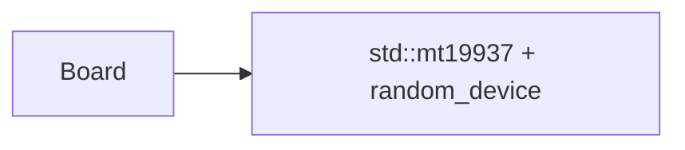
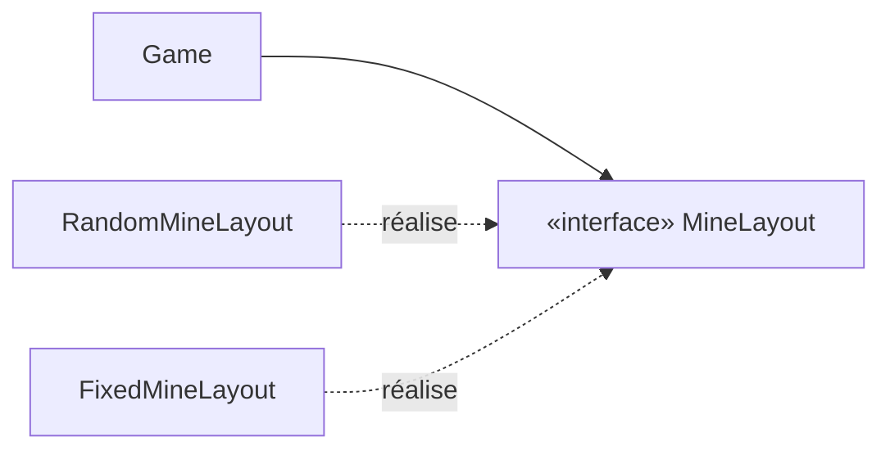

# Le hasard et le premier clic sûr

> **Objectif.** Placer les mines au hasard sans rendre le cœur intestable :
> première rencontre avec une **dépendance inversée** et une **doublure de
> test**.
>
> **Code :** [src/core/mine_layout.hpp](../src/core/mine_layout.hpp),
> [src/core/mine_layout.cpp](../src/core/mine_layout.cpp),
> [src/core/game.cpp](../src/core/game.cpp)

## Le besoin

Jusqu'ici, les tests de `Game` lui donnaient les mines **en dur**. Il faut
maintenant deux choses en apparence contradictoires :

- en production, des mines **au hasard**, et jamais sous le **premier clic**
  (la règle dit que les mines sont posées au moment du premier clic, ailleurs
  que sous la case choisie) ;
- dans les tests, des mines **connues** : comment vérifier « dévoiler une case
  vide ouvre toute la zone » si l'on ne sait pas où sont les mines ?

Le temps pose exactement le même problème (un chronomètre qui lit l'horloge ne
se teste qu'en attendant) ; on le règle avec la même idée à
l'[étape 17](17-session.md).

## Les options

| Option | Idée | Ce qui coince |
| --- | --- | --- |
| A. Un générateur dans `Game` | `std::mt19937_64 rng_` avec une graine passée au constructeur | les tests dépendent de l'implémentation du générateur : une graine « intéressante » aujourd'hui ne l'est plus si l'algorithme de tirage change |
| B. La liste des mines au constructeur | `Game(Size, vector<Pos>)` | parfait pour les tests, mais le **premier clic sûr devient impossible** : on ne connaît pas encore le clic quand on construit la partie |
| C. Une interface appelée au premier clic | `Game` reçoit un `MineLayout&` et lui demande les mines quand il connaît le premier clic | une indirection ; une classe abstraite à écrire |

Le critère qui tranche est le premier des trois : **peut-on tester sans
attendre et sans deviner ?** A échoue sur « deviner », B échoue sur la règle.

## La décision

L'option C. On ne dit plus à `Game` *comment* placer les mines ; on lui dit
seulement **qu'il existe quelqu'un qui sait le faire** :

```cpp
class MineLayout {
public:
    virtual ~MineLayout() = default;
    virtual std::vector<Pos> place(Size size, int count, Pos firstClick) = 0;
};
```

`Game` l'appelle au premier `reveal`, puis construit le `Minefield` :

```cpp
const Minefield& Game::plant(Pos firstClick) {
    const std::vector<Pos> mines = layout_->place(size(), mines_, firstClick);
    if (std::ssize(mines) != mines_ ||
        std::ranges::find(mines, firstClick) != mines.end())
        throw std::logic_error("Game: the mine layout broke its contract");
    return field_.emplace(size(), mines);
}
```

En production, la réalisation tire au sort parmi les cases qui ne sont ni le
premier clic ni, s'il y a la place, ses voisines (pour que le premier clic
ouvre une zone plutôt qu'un chiffre isolé) :

```cpp
std::vector<Pos> RandomMineLayout::place(Size size, int count, Pos firstClick) {
    const Neighbors around{size, firstClick};
    const bool roomy = size.area() - 1 - around.size() >= count;
    auto isSafe = [&](Pos p) {
        return p == firstClick || (roomy && std::ranges::find(around, p) != around.end());
    };

    std::vector<Pos> candidates;
    for (int i = 0; i < size.area(); ++i)
        if (const Pos p = size.posOf(i); !isSafe(p)) candidates.push_back(p);

    std::vector<Pos> mines;
    std::ranges::sample(candidates, std::back_inserter(mines), count, rng_);
    return mines;
}
```

Dans les tests, une seconde réalisation renvoie les mines que le test lui a
données ([test_doubles.hpp](../tests/test_doubles.hpp)) :

```cpp
class FixedMineLayout final : public MineLayout {
public:
    explicit FixedMineLayout(std::vector<Pos> mines) : mines_(std::move(mines)) {}

    std::vector<Pos> place(Size, int, Pos firstClick) override {
        ++calls;
        lastFirstClick = firstClick;
        return mines_;
    }

    int calls = 0;
    std::optional<Pos> lastFirstClick;

private:
    std::vector<Pos> mines_;
};
```

`Game` reçoit un `MineLayout&` et ne sait pas lequel il manipule. *Qui dépend
de qui ?* `Game` dépend de l'interface `MineLayout`, qui vit dans `core/` ;
`RandomMineLayout` et `FixedMineLayout` dépendent d'elle aussi. Personne ne
dépend du générateur.

## Les concepts

### Le polymorphisme par interface

Un même appel, `layout_->place(...)`, exécute un code différent selon l'objet
réel : c'est le **polymorphisme**. Le vocabulaire (`virtual`, `= 0`,
`override`, `final`, destructeur virtuel) a été vu à l'[étape 15](15-commandes.md).
Ce qu'on découvre ici, c'est **à quoi il sert vraiment** : à ce que celui qui
utilise ne connaisse pas celui qui réalise.

### L'inversion de dépendance

Regardons les flèches. Avant, le domaine dépend d'un détail technique :



Après, le domaine **définit** l'interface dont il a besoin, et le détail
technique s'y conforme :



C'est le **principe d'inversion des dépendances** (le « D » de SOLID) : les
modules de haut niveau ne dépendent pas des modules de bas niveau ; les deux
dépendent d'abstractions. L'interface `MineLayout` appartient au **domaine**,
pas à l'implémentation. C'est le domaine qui dit « voici ce dont j'ai
besoin ». À l'[étape 5](05-choisir-une-architecture.md), c'était un argument
sur un schéma ; le voici dans le code.

### L'injection de dépendance

Qui crée le `RandomMineLayout` et le passe à `Game` ? Personne dans le
domaine. Les dépendances arrivent **par le constructeur**, depuis le bord du
programme ([étape 19](19-lanceur.md)) :

```cpp
RandomMineLayout layout{options.seed.value_or(std::random_device{}())};
```

Aucune classe ne va chercher elle-même ses collaborateurs, ni dans une
variable globale, ni dans un singleton. Résultat : en production on injecte le
vrai hasard ; dans les tests, `FixedMineLayout` ; et avec `--seed 42`, une
partie devient **reproductible**, ce qui est précieux pour un rapport de bug.
Même `std::random_device`, la seule source vraiment imprévisible, n'apparaît
qu'au bord. Le domaine est **déterministe**.

### La doublure de test, et le contrat

`FixedMineLayout` est une **doublure** : un objet qui remplace un
collaborateur pour les besoins d'un test. Celle-ci est un **stub** (elle
renvoie ce qu'on lui a donné) doublé d'un **espion** (elle note combien de
fois et avec quel premier clic on l'a appelée). On en verra d'autres à
l'[étape 22](22-tests.md).

Une interface est un **contrat** : `place()` doit renvoyer exactement `count`
positions distinctes, dans la grille, sans le premier clic. Mais `Game` ne
contrôle pas qui l'implémente. Il vérifie donc ce qu'il reçoit (le
`logic_error` de `plant()`), et le constructeur de `Minefield` vérifie le
reste (positions dans la grille, sans doublon). L'agrégat ne laisse **rien**
entrer qui pourrait casser ses invariants, même venant d'un collaborateur.

### Quand **ne pas** créer d'interface

Une interface a un coût : une indirection, un fichier de plus, une couche que
le lecteur doit traverser. Ce projet n'en crée que pour l'une de deux raisons :

1. **Substituer** : il existe réellement une seconde implémentation, en général
   celle des tests ;
2. **Restreindre une frontière** : un client ne doit voir qu'une partie des
   capacités d'un objet.

| Interface | Implémentation réelle | Raison |
| --- | --- | --- |
| `MineLayout` | `RandomMineLayout` | substitution : `FixedMineLayout` dans les tests |
| `Clock` | `SteadyClock` | substitution : `FakeClock` dans les tests |
| `CommandSink` | `Session` | substitution : `RecordingSink` dans les tests |
| `GameView` | `Session` | frontière : l'interface ne voit que des questions |

Il n'y a **pas** d'interface `IGame` ni `IMinefield` : rien ne les
remplacerait et aucune frontière ne les justifie. Une interface sans raison
n'est que de la cérémonie.

## Vérifier

- [mine_layout_tests.cpp](../tests/mine_layout_tests.cpp) teste le contrat de
  `RandomMineLayout` :

  - `PlacesTheRequestedNumberOfDistinctMines` ;
  - `KeepsTheOpeningFreeWhenThereIsRoom` : 64 − 9 = 55 mines, la zone 3 × 3
    reste libre ;
  - `OnlySparesTheFirstClickOnACrowdedGrid` : 8 mines sur 3 × 3, seul le
    clic est épargné ;
  - `IsReproducibleWithTheSameSeed`.
- [game_tests.cpp](../tests/game_tests.cpp) : `PlantsMinesOnTheFirstRevealOnly`
  utilise l'espion : après deux `reveal`, `layout.calls == 1` et
  `layout.lastFirstClick == Pos{2, 2}`.
- `RejectsALayoutThatBreaksItsContract` donne à `Game` une doublure menteuse
  (une mine sous le premier clic, puis trop peu de mines) et attend
  `std::logic_error`.

## À retenir

- Le polymorphisme sert surtout à **découpler** : celui qui utilise ne connaît
  pas celui qui réalise.
- **Inversion des dépendances** : le domaine définit les interfaces dont il a
  besoin ; les détails techniques s'y conforment.
- **Injection** : les dépendances arrivent par le constructeur, assemblées au
  bord du programme.
- Une **doublure** remplace un collaborateur dans un test ; le cœur reste
  **déterministe**.
- Une interface se justifie par une **substitution** réelle ou une
  **frontière** à restreindre, jamais par habitude.

## Exercices

1. Écrivez (sur papier) une `MineLayout` qui garantit une partie résoluble
   sans deviner. Faut-il modifier `Game` ?
2. Pourquoi `RandomMineLayout` n'a-t-il pas de constructeur par défaut qui
   appellerait `std::random_device` ?
3. Supprimez la vérification du contrat dans `Game::plant`. Quel test échoue,
   et que se passerait-il en production avec une `MineLayout` boguée ?
