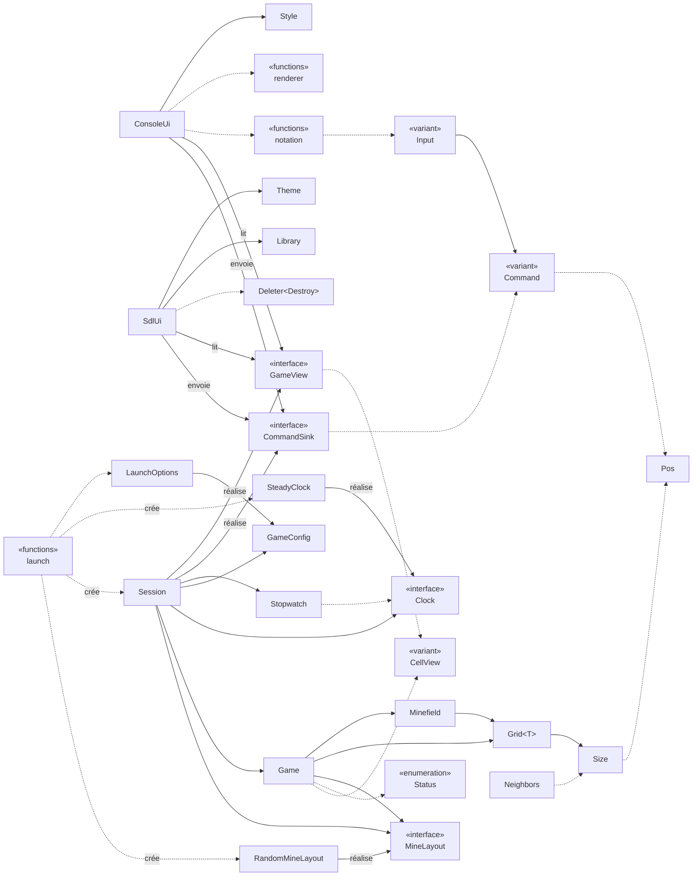
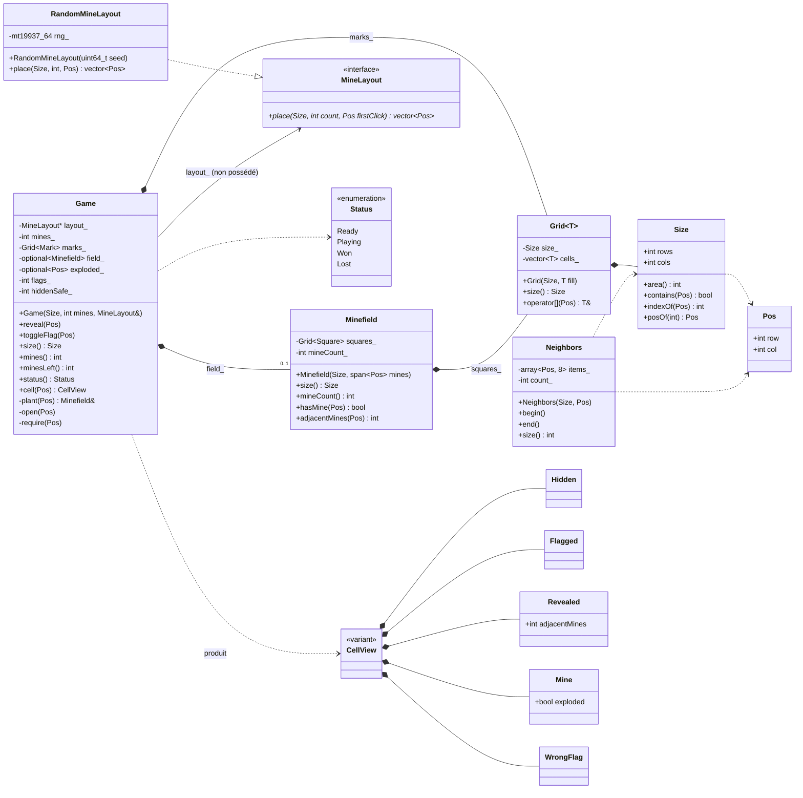
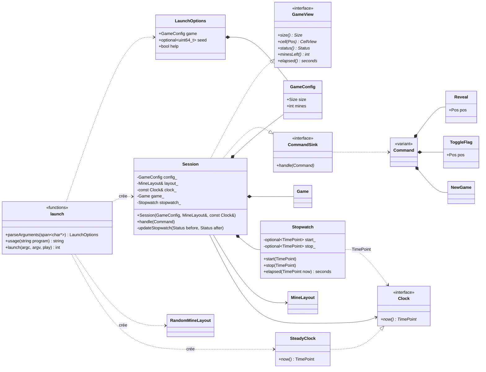
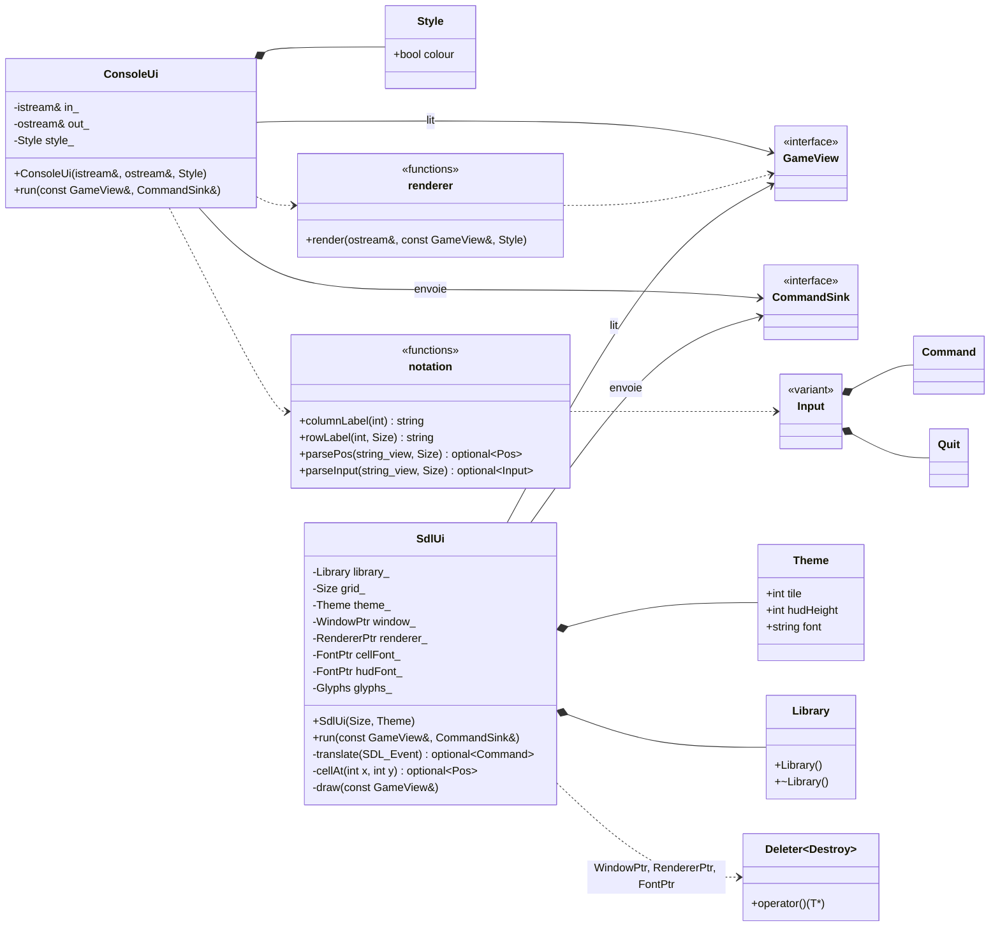

# Diagramme de classes

Ces diagrammes couvrent tout le code de production de `src/`. Ils sont écrits
à la main d'après les en-têtes ; la configuration [.clang-uml](../.clang-uml)
permet d'en générer un équivalent depuis le code.

Le premier montre toutes les classes et toutes leurs relations, sans les
membres. Les suivants détaillent chaque couche, membres compris.

## Vue complète

Flèche pleine : composition, référence ou pointeur ; « réalise » : la classe
implémente l'interface ; flèche pointillée : simple dépendance.

Les flèches ne traversent les couches que dans un sens : `console` et `sdl`
connaissent `app`, `app` connaît `core`, et `core` ne connaît personne. Les
deux adaptateurs ne voient la session qu'à travers ses ports `GameView` et
`CommandSink` ; seul `launcher` connaît la classe concrète `Session`.

## Le domaine (`core`)

## L'application et le lanceur (`app`, `launcher`)

## Les adaptateurs (`console`, `sdl`)

## Légende

Stéréotypes
:   `<<interface>>` : classe abstraite pure (un port) ; `<<variant>>` :
    `std::variant` dont les alternatives sont reliées par une composition ;
    `<<functions>>` : fonctions libres d'un même en-tête.

Relations
:   losange plein : composition (membre par valeur) ; flèche pleine :
    référence ou pointeur non possédé ; triangle pointillé : réalisation d'une
    interface ; flèche pointillée : simple dépendance (paramètre, type de
    retour).

Hors des diagrammes
:   les doublures de test de [tests/test_doubles.hpp](../tests/test_doubles.hpp)
    (`FixedMineLayout`, `FakeClock`, `RecordingSink`) réalisent les mêmes
    ports que `RandomMineLayout`, `SteadyClock` et `Session`.
