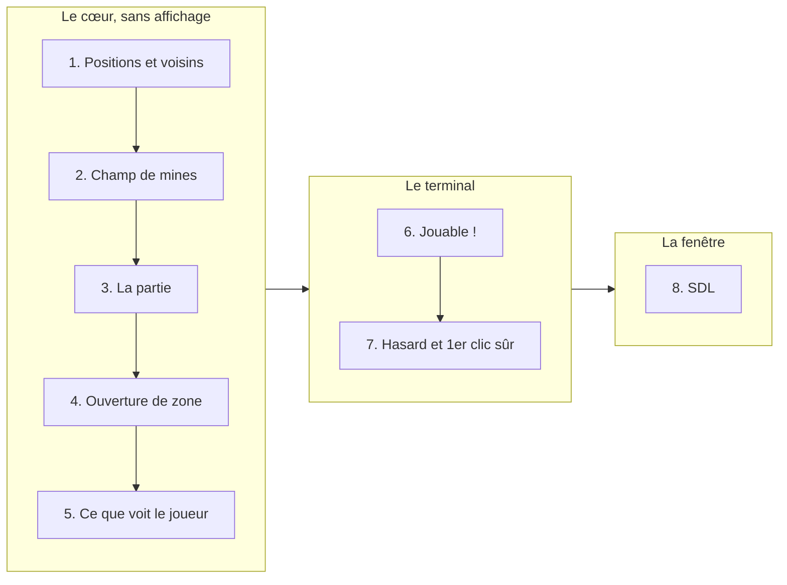

# Labo : écrire un démineur

Le jeu, et l'exemple de ce que vous allez construire (dans le terminal puis
dans une fenêtre), sont présentés au chapitre
[Le démineur](../docs/01-le-demineur.md). Lisez-le d'abord.

Le fil rouge du labo tient en une phrase : si vos règles du jeu sont écrites
correctement, ajouter une fenêtre graphique à la fin ne doit demander
**aucune** modification des règles. Si vous devez les toucher, c'est que
quelque chose était mal découpé, et la fenêtre vous le dira.

## Pourquoi commencer par le terminal ?

Parce qu'une interface graphique apporte beaucoup de difficultés qui n'ont
rien à voir avec le démineur : fenêtres, polices, événements de souris,
libération des ressources. Le terminal, lui, ne demande que `std::cout` et
`std::getline`. On peut ainsi se concentrer sur l'essentiel : **les règles
du jeu et la façon de les organiser en objets**.

Et surtout, on ne commence **même pas** par le terminal. On commence par le
**cœur**, sans aucun affichage, et on le vérifie par des tests. L'affichage
n'arrive qu'une fois les règles terminées.

## Comment on va construire le jeu

On construit **de l'intérieur vers l'extérieur** : d'abord les briques les
plus simples et les plus stables, puis ce qui s'appuie dessus, et
l'affichage en dernier.

| Étape | Ce que vous écrivez | Ce que vous apprenez |
| --- | --- | --- |
| 0 | Une grille sur papier et un lexique | Un concept du jeu = un type |
| [1](01-positions/) | `Pos`, `Size`, les voisins | Objet valeur, `struct` |
| 2 | `Minefield`, construit depuis une liste de mines | Invariant, encapsulation, `const` |
| 3 | `Game` : dévoiler, marquer, gagné/perdu | Où placer une règle, source unique de vérité |
| 4 | L'ouverture de zone, récursive puis itérative | Pile d'appels, parcours de graphe |
| 5 | Ce que le joueur a le droit de voir | Projection : l'affichage ne voit pas les mines cachées |
| 6 | Affichage, saisie et boucle dans le terminal | Séparation modèle/vue. **Le jeu est jouable** |
| 7 | Le hasard, et un premier clic toujours sûr | Polymorphisme, injection de dépendance |
| 8 | La fenêtre SDL | Le cœur ne bouge pas, RAII |

Pendant les étapes 1 à 5, **rien ne s'affiche**. C'est normal et voulu :
vous construisez un moteur, et ce sont les tests qui vous disent s'il
fonctionne. À l'étape 6, vous branchez ce moteur sur le terminal, et tout ce
que vous avez écrit prend vie d'un coup.

## Comment se déroule chaque étape

Chaque étape a son dossier avec :

- un **énoncé** (`README.md`) : l'objectif, ce qu'il faut comprendre avant
  de coder, l'interface exacte à écrire, les pièges fréquents et quelques
  questions ;
- des **tests fournis**, qui échouent tant que votre code n'est pas écrit ;
- un **Makefile** : `make test` compile et lance les tests.

Le travail suit toujours le même cycle :

1. Lire l'énoncé, en particulier « Ce qu'il faut comprendre avant de
   commencer ».
2. Écrire le code demandé, jusqu'à ce que `make test` passe **sans aucun
   avertissement** du compilateur.
3. Répondre aux questions de fin d'énoncé.
4. Faire un *commit* : une étape terminée = un commit.

L'étape suivante repart de **votre** code. Il n'y a rien à jeter : chaque
étape ajoute une pièce au même jeu.

## Deux règles pour tout le labo

1. **Pas de hasard avant l'étape 7.** Les mines sont données à la main, par
   exemple `{{0, 0}, {2, 1}}`. Chaque test donne alors toujours le même
   résultat, et un bug se reproduit à coup sûr.
2. **Le jeu ne sait pas s'afficher.** Aucun `#include <iostream>` dans les
   classes du jeu. L'affichage est un travail séparé (étape 6). C'est cette
   règle qui permettra, à l'étape 8, d'ajouter une fenêtre sans toucher au
   jeu.

Ces deux règles peuvent sembler arbitraires au début. Elles seront
justifiées, la première à l'étape 7 et la seconde à l'étape 8.

## Étape 0 : sur papier

Avant d'écrire une ligne de code, dessinez une grille 5 × 5 avec 3 mines et
remplissez les chiffres à la main. Puis répondez par écrit :

1. Quels **mots** utilisez-vous pour parler du jeu ? (case, mine, voisin,
   drapeau, partie gagnée...) Faites-en la liste.
2. Pour chaque mot : est-ce une **donnée** (une position, un nombre), ou une
   chose qui **change** au cours de la partie ?
3. Combien de voisines a une case dans un coin ? Sur un bord ? Au milieu ?
4. Qu'est-ce qui reste **identique** pendant toute la partie, et qu'est-ce qui
   **évolue** ?

La question 4 est la plus importante : elle prépare la séparation entre le
champ de mines, qui ne change jamais, et les actions du joueur, qui changent
tout le temps.

## Pour aller plus loin

Le dossier [`src/`](../src/) contient une version complète et soignée du
jeu, et la [documentation](../docs/README.md) en explique chaque choix de
conception. Lisez le chapitre correspondant **après** avoir terminé une
étape, jamais avant : c'est plus instructif de comparer sa solution à une
autre que de recopier.
